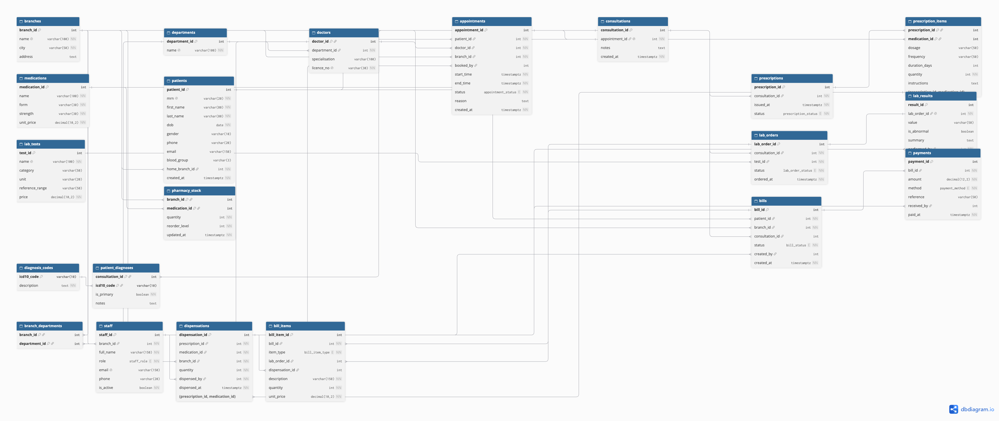
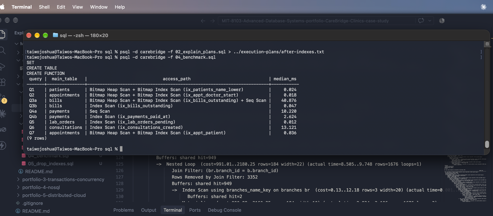
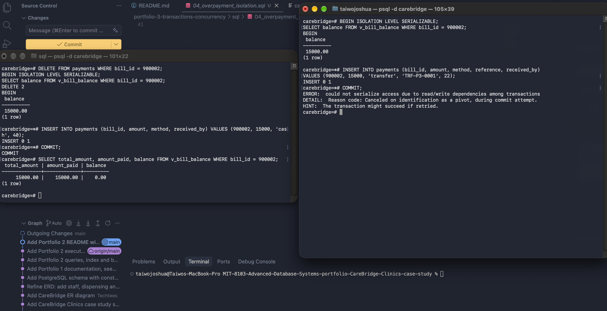
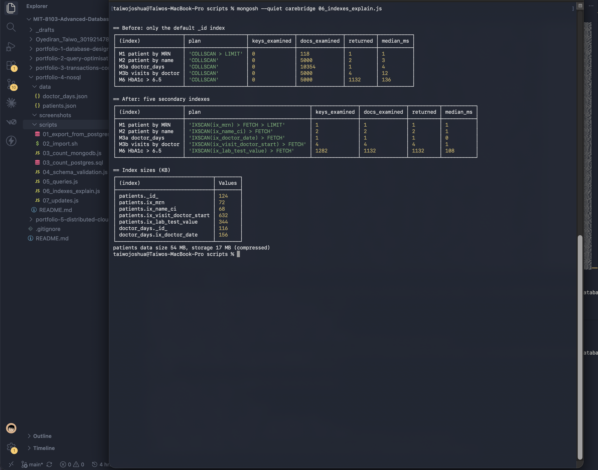
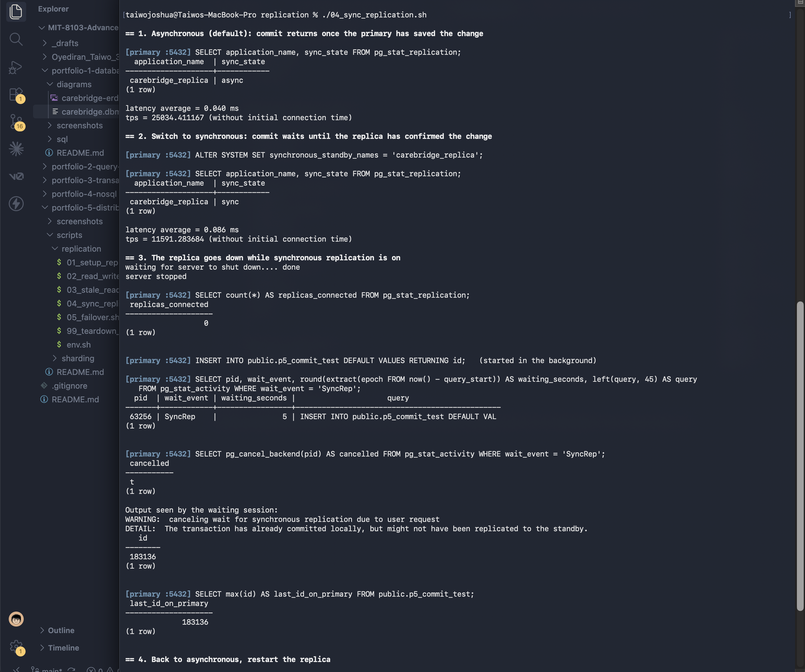
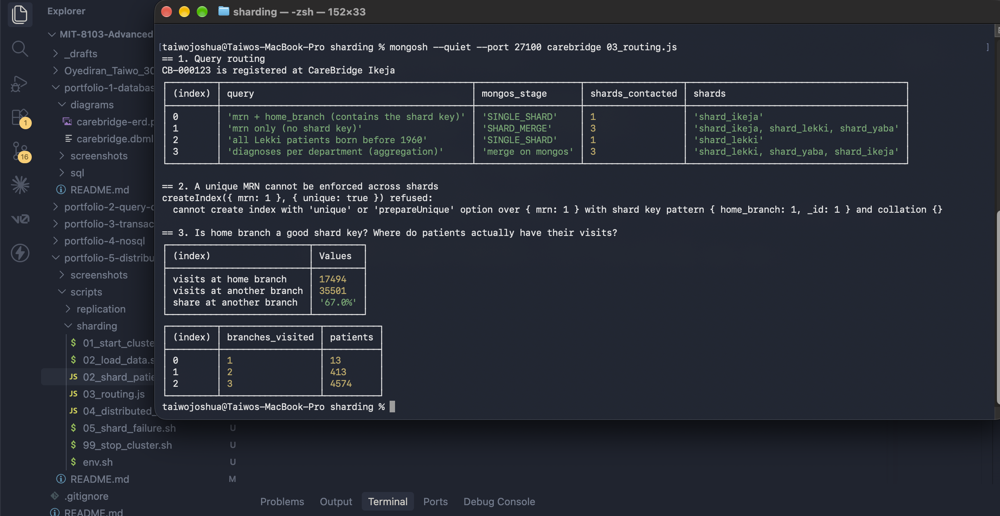

# CareBridge Clinics: Advanced Database Systems Portfolio

Name: Oyediran Taiwo

Student ID: 301921478

Course: MIT 8103 Advanced Database Systems, Continuous Assessment, 2026/2027 First Semester, MIVA Open University

GitHub repository (public): [github.com/Techtees/Oyediran_Taiwo_301921478](https://github.com/Techtees/Oyediran_Taiwo_301921478)

## 1. Selected Organisation

CareBridge Clinics is a simulated private outpatient provider with three branches in Lagos (Ikeja, Lekki and Yaba). Each branch offers general and specialist consultations, an in-house pharmacy and a laboratory. A patient can register at one branch and be treated at any other, so all three branches work from one shared database. Its users are receptionists (registration and booking), doctors (consultations, diagnoses, prescriptions and lab requests), laboratory scientists (results), pharmacists (dispensing and branch stock), billing officers (bills and payments) and administrators. The database stores branches, departments, staff and doctors, patients, appointments, consultations, ICD-10 diagnoses, prescriptions, medications and stock, lab orders and results, bills and payments. Its key operations are booking without double-booking a doctor, dispensing with stock updates, billing with part payments and retrieving a patient's history across all branches. All data is synthetic: about 495,000 rows produced by a repeatable seed script.

## 2. Summary of the Five Portfolio Activities

### Portfolio 1: Database Design and Modelling (PostgreSQL 16)
The ER model was drawn in DBML and implemented as 21 tables and 7 enum types, normalised to BCNF with a worked UNF to 3NF example based on a real visit. Business rules live in the schema itself: an `EXCLUDE USING gist` constraint stops a doctor having overlapping appointments, a composite foreign key on `(staff_id, role)` allows only doctor-role staff to be doctors, a partial unique index permits one primary diagnosis per consultation, and CHECK constraints keep stock and payments valid. `appointments.branch_id` is stored on purpose because doctors rotate between branches, while the bill total is left to the `v_bill_balance` view so it can never drift from its items. All 25 constraint tests, run inside a rolled-back transaction, behaved as expected.

### Portfolio 2: Query Processing and Optimisation
Nine everyday queries were profiled with `EXPLAIN (ANALYZE, BUFFERS)` and timed as the median of seven runs, before and after six targeted indexes (2.9 MB). An expression index on `lower(name)`, a composite `(doctor_id, start_time)` index and two partial indexes made lookups 56–174 times faster. Two queries needed rewriting instead: the view-based outstanding-bills query totalled all 40,990 bills before filtering, and a `LATERAL` rewrite cut it from 41.5 ms to 0.047 ms; a `date_trunc()` filter could only use its index once written as a date range. The diagnosis report read 27% of its table and gained nothing from an index, showing that more indexes are not always the answer.

### Portfolio 3: Transactions and Concurrency
Two `psql` sessions side by side showed COMMIT, a ROLLBACK caused by a CHECK violation, and a SAVEPOINT keeping the successful part of a dispense. Four problems were reproduced and fixed: a lost stock update (6 left instead of 2), fixed with `SELECT … FOR UPDATE` or REPEATABLE READ plus retry; double booking, stopped by the exclusion constraint although both receptionists' checks found the slot free; overpayment of one bill, a write skew that REPEATABLE READ allowed and only SERIALIZABLE (SSI) or locking the bill row prevented; and a deadlock, removed by locking rows in a fixed order. Under a 10-client `pgbench` load, read-then-write lost 1,748 of 2,000 updates, while a single atomic `UPDATE` lost none and was fastest (18,286 tps).

### Portfolio 4: NoSQL and Advanced Data Models (MongoDB 7.0)
Patients were remodelled as documents with their visits, diagnoses, prescriptions, lab results and bills embedded, plus `doctor_days` buckets for diaries. After migration every count matched PostgreSQL, including the ₦1,034,296,105 total billed. A `$jsonSchema` validator rejected malformed records but accepted a visit for a doctor who does not exist, since there are no foreign keys. The Portfolio 2 queries gave the same results and indexes turned collection scans into index scans. One patient's history became a single read, but reports across all patients were slower, renaming one doctor touched 2,029 documents, and multi-document transactions were refused on a standalone server. PostgreSQL therefore stays the system of record, with MongoDB as a read model.

### Portfolio 5: Distributed and Cloud Database Exercise
A PostgreSQL streaming replica refused writes and returned a stale read while replay was paused. Synchronous commit doubled latency (from 0.040 ms to 0.086 ms), and with the replica down a write waited until cancelled, choosing consistency over availability; promoting the replica while the old primary ran caused split brain. A MongoDB cluster with one shard per branch sent shard-key queries to one shard and others to all three, refused a unique MRN index, committed a booking atomically across two shards, and kept Ikeja and Lekki working when the Yaba shard stopped. Because 67% of visits happen away from the patient's home branch, I recommend a replicated, unsharded managed PostgreSQL deployment in the cloud, with CAP choices set per type of data.

<figure><figcaption>Fig. 1 ER diagram (Portfolio 1)</figcaption></figure>
<figure><figcaption>Fig. 2 Access paths and median times after indexing (P2)</figcaption></figure>
<figure><figcaption>Fig. 3 SERIALIZABLE cancels the second payment (P3)</figcaption></figure>
<figure><figcaption>Fig. 4 COLLSCAN to IXSCAN in MongoDB (P4)</figcaption></figure>
<figure><figcaption>Fig. 5 Synchronous commit waiting on SyncRep (P5)</figcaption></figure>
<figure><figcaption>Fig. 6 Targeted vs scatter-gather routing (P5)</figcaption></figure>

All scripts, full outputs, execution plans and further screenshots are in each portfolio folder of the repository. The repository was built up in 22 commits.

## 3. Individual Technical Reflection

Having worked in health technology for several years, I have seen some of the challenges healthcare providers face when managing patient information, appointments and records across different locations. I understand how frustrating inefficient systems can be, not just for healthcare workers but also for patients who depend on timely and accurate care. This experience influenced my choice of CareBridge Clinics as my case study. I chose Lagos because it is a familiar environment where multiple healthcare branches may need to share patient information seamlessly. I wanted to build something that reflected challenges I could relate to, rather than simply create a database for an academic exercise.

The most challenging parts were Portfolio 3 (Transactions and Concurrency) and Portfolio 5 (Distributed and Cloud). Working with simultaneous transactions and distributed systems helped me appreciate how easily data inconsistencies can affect real operations. One surprising result was that REPEATABLE READ prevented lost updates but did not prevent overpayment. This taught me that database isolation levels do not automatically solve every concurrency problem.

I also encountered issues with MongoDB validation, particularly when 754 patients were initially exported with null blood groups. The validator did not detect existing invalid documents until an update was attempted. This reinforced the importance of verifying actual results rather than assuming scripts have worked correctly.

Using AI assistance helped me explore unfamiliar concepts and review my scripts, but testing everything against actual database output taught me the importance of independent verification.

If I started again, I would include the staff supertype in the initial ERD, investigate cross-branch visits before choosing a shard key and commit my work more frequently.

My biggest takeaway is that database engineering is ultimately about people, not just data. Behind every patient record, appointment or prescription is someone depending on the system to work correctly. That is the perspective I hope to carry into my future work.

## 4. AI Use Declaration

**Tool:** Claude (Anthropic), model Claude Opus 5.5, used through the Claude Code extension in Visual Studio Code.

**What it was used for:**
- Reviewing my ER diagram and suggesting changes, which I considered and applied: the staff/doctor supertype, dispensations and bill items.
- Reviewing the SQL, shell and JavaScript scripts I wrote for the five portfolios and pointing out errors and possible improvements.
- Producing first drafts of the portfolio READMEs and sections 1–2 of this document from my own scripts, results and screenshots. I checked every statement against my results, corrected errors and rewrote the text in my own words.

**How I reviewed and verified the output:**
- I ran every script myself on my own machine (PostgreSQL 16.16, MongoDB 7.0), and all screenshots and numbers in the repository come from my own runs.
- I checked results independently: the 25 constraint tests, identical results for the rewritten and original queries, MongoDB counts and query results against PostgreSQL, and the expected outcome of each concurrency step.
- I only accepted review suggestions I understood and had tested, and I can explain every script and design decision.

## References

Abadi, D. (2012) 'Consistency tradeoffs in modern distributed database system design: CAP is only part of the story', *Computer*, 45(2), pp. 37–42.

Elmasri, R. and Navathe, S.B. (2016) *Fundamentals of Database Systems*. 7th edn. Boston: Pearson.

Federal Republic of Nigeria (2023) *Nigeria Data Protection Act, 2023*. Abuja: Federal Government of Nigeria.

Gilbert, S. and Lynch, N. (2002) 'Brewer's conjecture and the feasibility of consistent, available, partition-tolerant web services', *ACM SIGACT News*, 33(2), pp. 51–59.

Holistics (2026) *dbdiagram.io: Database relationship diagrams design tool*. Available at: https://dbdiagram.io.

Kleppmann, M. (2017) *Designing Data-Intensive Applications*. Sebastopol, CA: O'Reilly Media.

MongoDB, Inc. (2026) *MongoDB Manual v7.0: Data Modeling, Schema Validation, Sharding and Transactions*. Available at: https://www.mongodb.com/docs/v7.0/.

Ports, D.R.K. and Grittner, K. (2012) 'Serializable snapshot isolation in PostgreSQL', *Proceedings of the VLDB Endowment*, 5(12), pp. 1850–1861.

PostgreSQL Global Development Group (2026) *PostgreSQL 16 Documentation: Indexes, Using EXPLAIN, Concurrency Control and High Availability*. Available at: https://www.postgresql.org/docs/16/.

Silberschatz, A., Korth, H.F. and Sudarshan, S. (2019) *Database System Concepts*. 7th edn. New York: McGraw-Hill.

