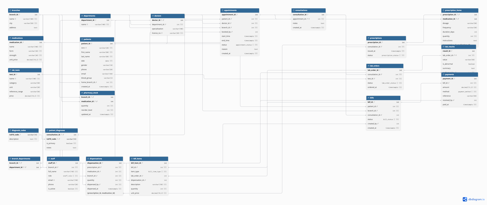
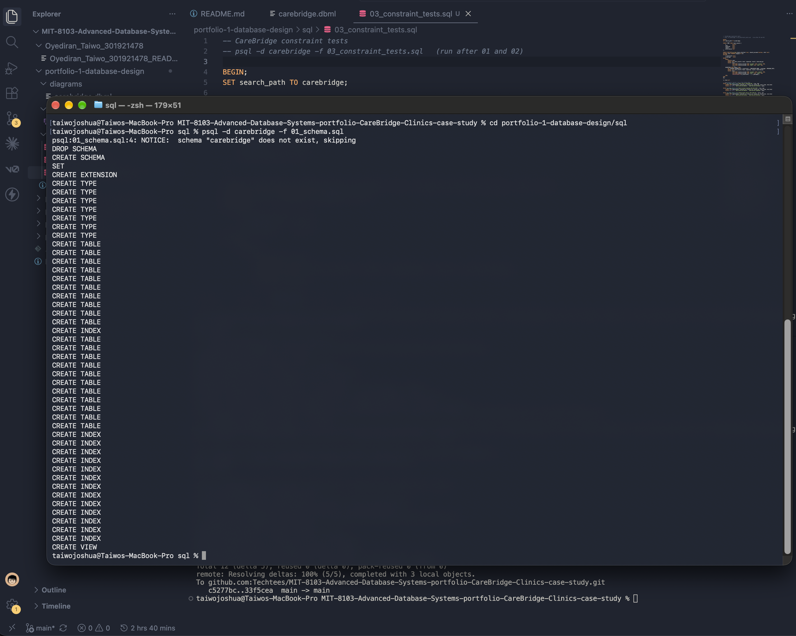
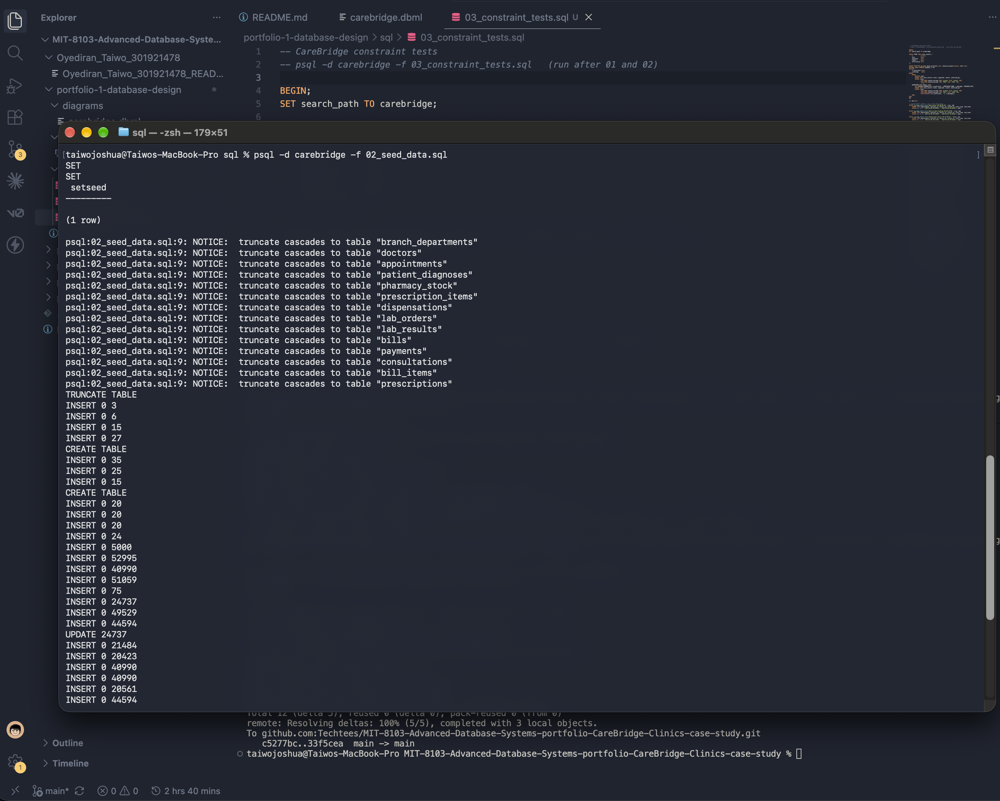
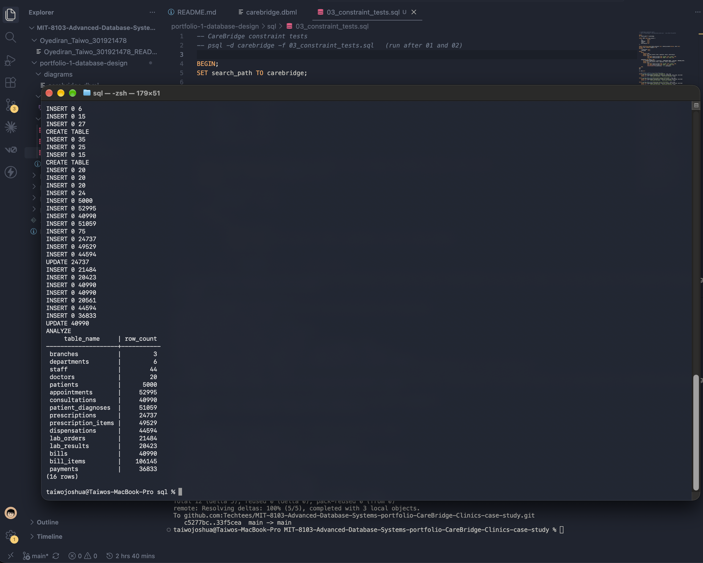
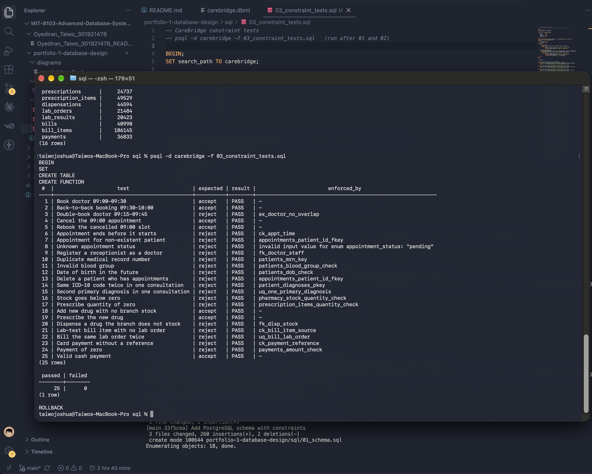

# Portfolio 1: Database Design and Modelling

CareBridge Clinics is a simulated private outpatient provider with three branches in Lagos (Ikeja, Lekki and Yaba). A patient can register at one branch and be seen at any other, so every branch shares one database for patients, appointments, consultations, prescriptions, lab work and billing. This portfolio covers the design of that database: the ER model, the relational schema in PostgreSQL with its keys and constraints, normalisation, and synthetic test data that later portfolios build on. The full case study is in the [root README](../README.md).

**DBMS:** PostgreSQL 16

## Contents

| File | Purpose |
|---|---|
| [diagrams/carebridge.dbml](diagrams/carebridge.dbml) | ER model source (dbdiagram.io) |
| [diagrams/carebridge-erd.png](diagrams/carebridge-erd.png) | ER diagram image |
| [sql/01_schema.sql](sql/01_schema.sql) | Tables, keys, constraints, indexes, view |
| [sql/02_seed_data.sql](sql/02_seed_data.sql) | Synthetic test data |
| [sql/03_constraint_tests.sql](sql/03_constraint_tests.sql) | 25 constraint tests |
| [screenshots/](screenshots/) | Output of each script |

## 1. ER Diagram



I grouped the 21 tables into five areas so the diagram follows how a patient moves through a clinic:

- **Organisation** – `branches`, `departments`, `branch_departments`, `staff`, `doctors`. Who works where and in which department.
- **Patients and visits** – `patients`, `appointments`, `consultations`. A booking becomes a consultation once the patient is actually seen.
- **Clinical** – `diagnosis_codes`, `patient_diagnoses`, `lab_tests`, `lab_orders`, `lab_results`. What the doctor found and which tests were ordered.
- **Pharmacy** – `medications`, `pharmacy_stock`, `prescriptions`, `prescription_items`, `dispensations`. What was prescribed, what each branch holds, and what was handed over.
- **Billing** – `bills`, `bill_items`, `payments`. What the patient owes and what they have paid.

### Relationships

| Type | Example from CareBridge | How it is implemented |
|---|---|---|
| 1:1 | One appointment produces at most one consultation | `consultations.appointment_id` is a FK to `appointments` and is also `UNIQUE`. The same pattern links `lab_results` to `lab_orders`. |
| 1:N | One patient has many appointments | `appointments.patient_id` FK to `patients(patient_id)`, `NOT NULL`. |
| M:N | Branches stock many medications, and a medication is stocked at many branches | Junction table `pharmacy_stock` with composite PK `(branch_id, medication_id)` and a `quantity` attribute. `branch_departments` and `prescription_items` work the same way. |
| Supertype / subtype | Every doctor is a staff member, but only some staff are doctors | `doctors.doctor_id` is the PK and also a FK to `staff`. The composite FK `fk_doctor_staff (doctor_id, role) → staff(staff_id, role)` with `role` fixed to `'doctor'` stops a receptionist being added as a doctor. |

## 2. Keys

- **Surrogate keys.** Every main table uses an `INT GENERATED ALWAYS AS IDENTITY` primary key. Names are not unique, phone numbers change and can be shared within a family, and patients may not have an email. A generated number never changes, so foreign keys pointing at it never have to be updated, and it is small and fast to join on.
- **Natural values that are still unique.** I kept business identifiers as `UNIQUE` so duplicates cannot slip in: `patients.mrn` (one medical record number per patient), `doctors.licence_no` (one licence per doctor), `staff.email`, `branches.name`, `departments.name`, `lab_tests.name`, and `(name, form, strength)` on `medications`. The `diagnosis_codes` table is the exception: the ICD‑10 code is already a stable standard code, so it is the primary key itself.
- **Composite keys on junction tables.** In `pharmacy_stock` the row only means something as "this medication at this branch", so `(branch_id, medication_id)` is the natural identifier and also stops the same drug being listed twice for one branch. The same applies to `branch_departments`, `prescription_items` and `patient_diagnoses`. It also lets `dispensations` reference those pairs directly through composite foreign keys.

## 3. Constraints

| Business rule | Constraint |
|---|---|
| A doctor cannot have two active appointments that overlap in time | `ex_doctor_no_overlap` |
| An appointment must end after it starts | `ck_appt_time` |
| Only a staff member whose role is `doctor` can have a doctor record | `fk_doctor_staff` |
| Two patients cannot share a medical record number | `patients_mrn_key` |
| Branch stock can never go below zero | `pharmacy_stock_quantity_check` |
| A branch can only dispense a medication it has a stock record for | `fk_disp_stock` |
| A consultation can have only one primary diagnosis | `uq_one_primary_diagnosis` |
| A lab‑test bill line must point to a lab order, a medication line must point to a dispensation, and other lines must point to neither | `ck_bill_item_source` |
| Any payment that is not cash must have a reference (card/transfer/HMO) | `ck_payment_reference` |

The double‑booking rule is the most interesting one. A normal `UNIQUE` can only catch identical values, but two appointments 09:00–09:30 and 09:15–09:45 are different values that still clash. `ex_doctor_no_overlap` is an `EXCLUDE` constraint (using the `btree_gist` extension) that rejects a new row if it has the same `doctor_id` **and** its time range overlaps (`&&`) an existing one. The range is half‑open `[)`, so a 09:30 booking right after a 09:00–09:30 one is allowed. The `WHERE (status <> 'cancelled')` part means cancelled appointments are ignored, so a cancelled slot can be rebooked straight away – tests 3, 4 and 5 show exactly this.

## 4. Normalisation

I started from one "visit slip": everything about a single clinic visit in one flat row. This is a real visit from the seed data (consultation 25924):

```sql
SET search_path TO carebridge;
SELECT p.mrn, p.first_name, p.last_name, s.full_name AS doctor, b.name AS branch,
       a.start_time::date, c.consultation_id
FROM patients p
JOIN appointments a  USING (patient_id)
JOIN consultations c USING (appointment_id)
JOIN staff s    ON s.staff_id  = a.doctor_id
JOIN branches b ON b.branch_id = a.branch_id
WHERE p.mrn = 'CB-000123';
```

**UNF**

| mrn | patient_name | doctor | department | branch | visit_date | diagnoses | drugs (qty @ price) | lab_tests |
|---|---|---|---|---|---|---|---|---|
| CB-000123 | Folake Salami | Dr Hadiza Abubakar | Paediatrics | CareBridge Lekki | 2026-03-09 | B54 | Ferrous sulphate ×11 @ 15.00, Chloramphenicol ×27 @ 800.00 | Haemoglobin genotype |

`diagnoses`, `drugs` and `lab_tests` are repeating groups: one visit can have several of each, so they are lists inside one cell.

**1NF**
I removed the repeating groups so every cell holds one value. Each list became its own table, one row per item: `patient_diagnoses` (consultation + ICD‑10 code), `prescriptions` / `prescription_items` (consultation + medication + quantity) and `lab_orders` (consultation + test). The visit itself stays in `appointments` / `consultations`.

**2NF**
In `prescription_items` the key is `(prescription_id, medication_id)`. If the drug's name, form and price were kept there, they would depend only on `medication_id`, which is just part of the key – a partial dependency. So they moved to `medications`, and `prescription_items` keeps only what depends on the whole key (dosage, frequency, quantity). The same reasoning moved the diagnosis description to `diagnosis_codes` and the test name and price to `lab_tests`.

**3NF**
In the flat row, `patient_name` depends on `mrn`, not on the visit (visit → patient → name), which is a transitive dependency. Patient details moved to `patients` and the visit only stores `patient_id`. Likewise `department` depends on the doctor, not the visit, so it lives in `doctors.department_id`, and branch details live in `branches`.

### Design decisions

1. **`appointments.branch_id` is stored even though staff belong to a branch.** Doctors rotate between branches – in the visit above, Dr Abubakar is based at Yaba but saw the patient at Lekki. The doctor's home branch does not tell us where a particular appointment took place, so the appointment records its own branch. This is a fact about the appointment, not a duplicate.
2. **`bills.status` is stored even though it could be calculated from payments.** Billing staff constantly filter by "unpaid" or "part paid", and a stored, indexed status is much cheaper than summing payments for every bill each time. It also lets a bill be marked `void`, which cannot be worked out from payments at all. The seed script sets it from the balance so it starts consistent.
3. **The bill total is not stored.** The total is just the sum of `quantity × unit_price` over its items, and the balance is that minus the payments. Storing them would mean every new item or payment had to update the bill too, and they could drift apart. The `v_bill_balance` view works them out when needed, so there is one source of truth.
4. **`bill_items` keeps its own `unit_price`.** Medication prices change over time. A bill is a record of what the patient was charged on that day, so it copies the price at billing time. If it always read `medications.unit_price`, old bills would change every time a price was updated.

## 5. Test Data

The seed script creates 3 branches, 44 staff (20 doctors), 5,000 patients and about 53,000 appointments, which lead to roughly 41,000 consultations, 51,000 diagnoses, 50,000 prescription items, 21,000 lab orders, 41,000 bills, 106,000 bill items and 37,000 payments. Portfolio 2 needs this volume because query plans and indexes only show real differences on tables large enough that a sequential scan is noticeably slow. All data is synthetic (no real patients), and `SELECT setseed(0.42)` at the top of the script makes `random()` give the same sequence every run, so the same data and row counts can be reproduced.

## 6. How to Run

```bash
createdb carebridge
cd portfolio-1-database-design/sql
psql -d carebridge -f 01_schema.sql
psql -d carebridge -f 02_seed_data.sql
psql -d carebridge -f 03_constraint_tests.sql
```

## 7. Evidence



*`01_schema.sql` runs without errors: the schema, extension, 7 enum types, 21 tables, indexes and the `v_bill_balance` view are all created.*



*`02_seed_data.sql` inserts the reference data and then the generated transactional data in dependency order, with no foreign key or check violations.*



*Row counts per table after seeding, showing the database is large enough for the optimisation work in Portfolio 2.*



*All 25 constraint tests pass (25 passed, 0 failed): valid rows are accepted, invalid rows are rejected by the named constraint, and the whole script rolls back so the data is left unchanged.*

## 8. Challenges and What I Learned

The first time I ran `01_schema.sql` it printed `NOTICE: schema "carebridge" does not exist, skipping`. At first I thought it was an error, but it comes from `DROP SCHEMA IF EXISTS` on a fresh database and is what makes the script safe to re-run. My first ERD also linked appointments, dispensing and lab results straight to doctors, which left no way to record which receptionist, pharmacist or lab scientist did the work, so I added a `staff` supertype with `doctors` as a subtype. Writing the constraint tests showed me that rules such as "no double booking" belong in the database itself, not only in the application.
