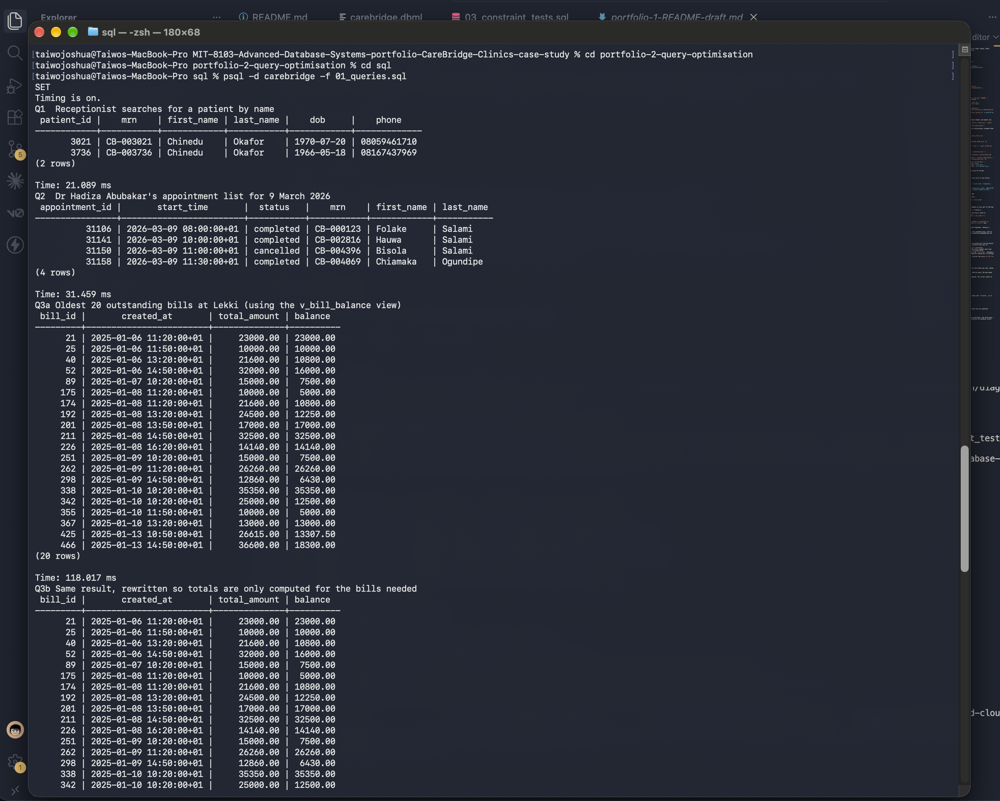
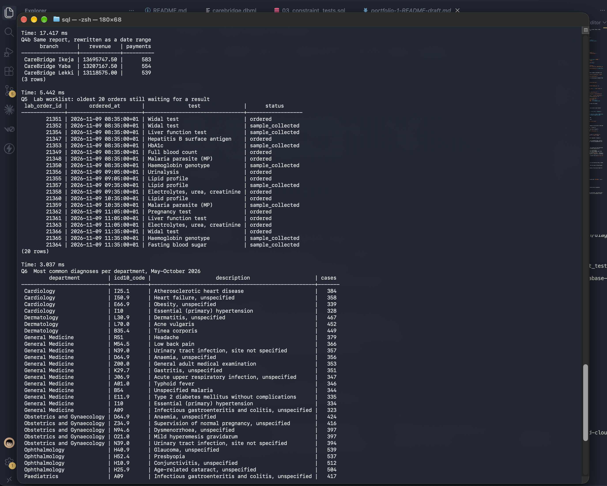
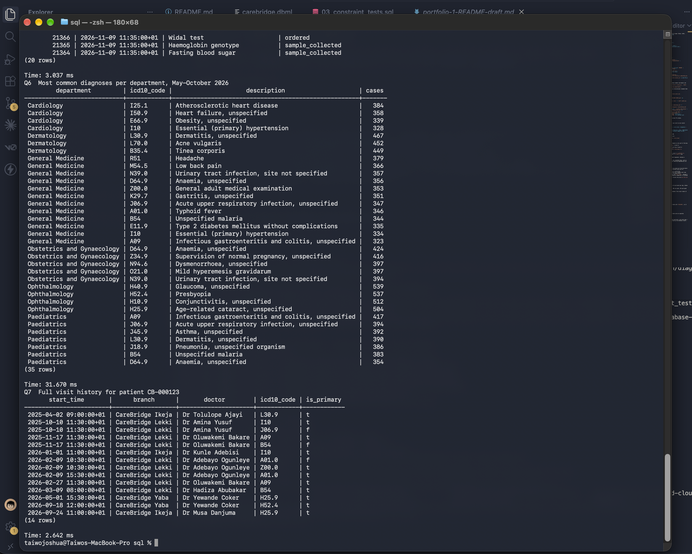
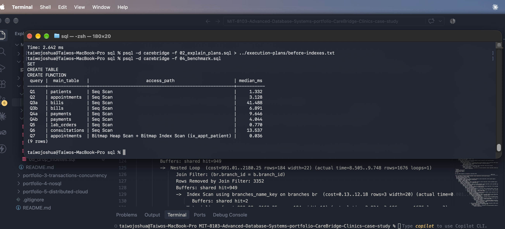
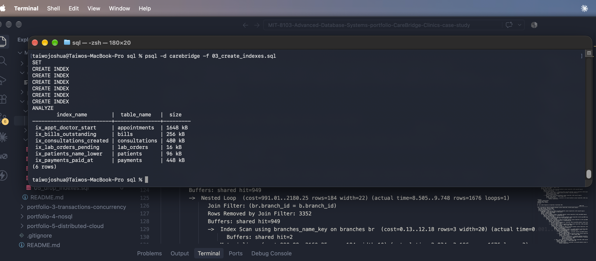
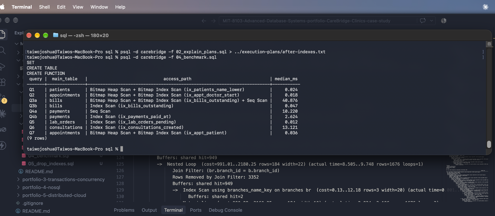

# Portfolio 2: Query Processing and Optimisation

This portfolio takes nine queries that CareBridge staff would really run every day and studies how PostgreSQL executes them on the seeded database. I captured the execution plan and a timed baseline for each one, then improved them with targeted indexes and, where an index alone was not enough, by rewriting the query. Finally I measured again, so every claim below is backed by a plan and a before/after number.

**DBMS:** PostgreSQL 16 · **Data:** the seeded `carebridge` database from [Portfolio 1](../portfolio-1-database-design/)

## Contents

| File | Purpose |
|---|---|
| [sql/Oyediran_Taiwo_301921478_P2_01_queries.sql](sql/Oyediran_Taiwo_301921478_P2_01_queries.sql) | The 9 workload queries and their results |
| [sql/Oyediran_Taiwo_301921478_P2_02_explain_plans.sql](sql/Oyediran_Taiwo_301921478_P2_02_explain_plans.sql) | `EXPLAIN (ANALYZE, BUFFERS)` for every query |
| [sql/Oyediran_Taiwo_301921478_P2_03_create_indexes.sql](sql/Oyediran_Taiwo_301921478_P2_03_create_indexes.sql) | The 6 indexes added after analysing the plans |
| [sql/Oyediran_Taiwo_301921478_P2_04_benchmark.sql](sql/Oyediran_Taiwo_301921478_P2_04_benchmark.sql) | Median of 7 timed runs per query, plus the access path used |
| [sql/Oyediran_Taiwo_301921478_P2_05_drop_indexes.sql](sql/Oyediran_Taiwo_301921478_P2_05_drop_indexes.sql) | Removes the indexes to return to the baseline |
| [execution-plans/Oyediran_Taiwo_301921478_P2_before-indexes.txt](execution-plans/Oyediran_Taiwo_301921478_P2_before-indexes.txt) | Full plans before optimisation |
| [execution-plans/Oyediran_Taiwo_301921478_P2_after-indexes.txt](execution-plans/Oyediran_Taiwo_301921478_P2_after-indexes.txt) | Full plans after optimisation |

## 1. The Workload

| # | Who uses it | What it does |
|---|---|---|
| Q1 | Receptionist, when a returning patient arrives without their MRN | Find a patient by name |
| Q2 | Doctor (or the receptionist preparing their clinic) at the start of the day | One doctor's appointments for a day |
| Q3a / Q3b | Billing officer chasing unpaid and part-paid bills | Oldest 20 outstanding bills at a branch (view vs rewrite) |
| Q4a / Q4b | Management / finance, for the monthly report | Monthly revenue per branch (`date_trunc` vs date range) |
| Q5 | Lab scientist, as their worklist of samples still to process | Lab orders still waiting for a result |
| Q6 | Clinical management, to plan staffing and drug stock | Most common diagnoses per department |
| Q7 | Doctor, before seeing a patient who has visited other branches | Full visit history for one patient |

Q1, Q2, Q5 and Q7 are short lookups run many times a day, so their response time is what staff feel. Q3, Q4 and Q6 are heavier reporting queries that read a large part of a table.

## 2. Method

- **Baseline.** I dropped all Portfolio 2 indexes (`Oyediran_Taiwo_301921478_P2_05_drop_indexes.sql`) so only the Portfolio 1 keys and indexes existed, ran the queries to check the results were correct (`Oyediran_Taiwo_301921478_P2_01_queries.sql`), and saved the full `EXPLAIN (ANALYZE, BUFFERS)` output to `Oyediran_Taiwo_301921478_P2_before-indexes.txt`.
- **Analyse.** For each plan I looked at which table was being read with a Seq Scan, how many rows it read versus how many it actually needed, and where the time went.
- **Improve.** I added one index per problem (`Oyediran_Taiwo_301921478_P2_03_create_indexes.sql`), choosing the index type to fit the query: an expression index, a composite index and partial indexes. For Q3 and Q4 I also wrote a rewritten version (Q3b, Q4b) that returns the same result.
- **Measure again.** I saved the new plans to `Oyediran_Taiwo_301921478_P2_after-indexes.txt` and re-ran `Oyediran_Taiwo_301921478_P2_04_benchmark.sql` to compare the times.

**Why the median of 7 runs?** A single timing is not reliable. In screenshot 1, Q1 took 21 ms the first time through psql, but the benchmark median is 1.3 ms. The first run includes reading pages from disk into the cache, planning the query and psql's own round-trip, and later runs can be disturbed by whatever else the laptop is doing. The benchmark does one warm-up run and then takes the median of 7 `EXPLAIN ANALYZE` execution times, so one slow or fast outlier cannot change the result, and before and after are compared under the same warm-cache conditions.

## 3. Results

| Query | Before: access path | Before (ms) | After: access path | After (ms) | Speed-up |
|---|---|---|---|---|---|
| Q1 | Seq Scan | 1.332 | Bitmap Index Scan `ix_patients_name_lower` | 0.024 | ≈ 56× |
| Q2 | Seq Scan | 3.128 | Bitmap Index Scan `ix_appt_doctor_start` | 0.018 | ≈ 174× |
| Q3a | Seq Scan | 41.488 | Index on bills + Seq Scan in view | 40.876 | none |
| Q3b | Seq Scan | 6.891 | Index Scan `ix_bills_outstanding` | 0.047 | ≈ 147× (≈ 880× vs Q3a) |
| Q4a | Seq Scan | 9.646 | Seq Scan | 10.220 | none |
| Q4b | Seq Scan | 4.044 | Index Scan `ix_payments_paid_at` | 2.624 | ≈ 1.5× |
| Q5 | Seq Scan | 0.770 | Index Scan `ix_lab_orders_pending` | 0.012 | ≈ 64× |
| Q6 | Seq Scan | 13.537 | Index Scan `ix_consultations_created` | 13.121 | none |
| Q7 | Bitmap Index Scan `ix_appt_patient` | 0.036 | unchanged | 0.036 | none (already optimal) |

## 4. Analysis

### Where indexes worked

- **Q1 – expression index.** The query searches on `lower(last_name)` and `lower(first_name)` so that "OKAFOR" and "okafor" both match. A normal index on `last_name` stores the original values, and PostgreSQL cannot use it for `lower(last_name)` because the function changes the value being compared. `ix_patients_name_lower` indexes the result of `lower(...)` itself, so the condition matches the index exactly and only the 2 matching rows are read instead of all 5,000 patients.
- **Q2 – composite column order.** The query has an equality on `doctor_id` and a range plus `ORDER BY` on `start_time`. With `(doctor_id, start_time)` the index jumps straight to doctor 9 and, inside that, the appointments are already in time order, so it reads just the 4 rows for 9 March. With the columns the other way round, the index would have to scan every doctor's appointments for that day and then filter. The exclusion constraint from Portfolio 1 does create a GiST index on `doctor_id`, but it indexes `tstzrange(start_time, end_time)` rather than `start_time`, and it is a partial index (`WHERE status <> 'cancelled'`) while Q2 also returns cancelled appointments, so the planner cannot use it for this query.
- **Q5 – partial index.** A partial index only contains the rows that match its `WHERE` clause. Only 138 of the 21,484 lab orders are still `ordered` or `sample_collected`, so `ix_lab_orders_pending` holds just those 138 entries and is 16 kB (about two pages), while completed orders are never included. Because it is sorted by `ordered_at`, the query reads the first 20 entries and stops.

### Where an index alone did not help

- **Q3a – the view computes everything first.** `v_bill_balance` totals `bill_items` and `payments` with `GROUP BY bill_id` across **all** 40,990 bills (the plan reads ~106,000 bill items and ~37,000 payments) before the outer query filters to Lekki's outstanding bills and keeps 20. The new `ix_bills_outstanding` index does find the 2,595 Lekki outstanding bills quickly, but that is only a small part of the work, so the time barely moves (41.5 → 40.9 ms). Q3b rewrites the query with `LATERAL` subqueries so the totals are computed per bill, and only after the index has picked the oldest 20. The plan shows the bill-item and payment lookups running only 20 times, and the query drops to 0.047 ms with the same result.
- **Q4a – a function on the column hides it from the index.** `date_trunc('month', paid_at ...) = '2026-03-01'` compares a calculated value, not `paid_at` itself, so the B-tree on `paid_at` cannot be used and PostgreSQL must calculate `date_trunc` for every payment (it was even slightly slower after, 9.6 → 10.2 ms, which is just noise). Q4b asks the same question as a range, `paid_at >= '2026-03-01' AND paid_at < '2026-04-01'`, which the index can use directly to find the 1,676 March payments. The gain is small (4.0 → 2.6 ms) because the plan still does a Seq Scan on all 40,990 `bills` to join each payment to its branch, and that join now takes most of the time.
- **Q6 – the index is used but the filter is not selective.** The May–October window covers 11,050 of 40,990 consultations, about 27% of the table. When a quarter of the rows match, reading them through an index is about as much work as just scanning the table, and the rest of the plan still hash-joins all 51,059 diagnoses and all 52,995 appointments, so the time stays at about 13 ms. For a report like this, a better solution is a pre-aggregated summary, e.g. a materialized view of diagnosis counts per department per month refreshed overnight, so the report reads a few hundred rows instead of joining tens of thousands.

### Already optimal

Q7 was fast before I added anything because Portfolio 1 already created the indexes it needs: the `UNIQUE` constraint on `patients.mrn` finds the patient, `ix_appt_patient (patient_id, start_time)` finds their 11 appointments, and the `UNIQUE` on `consultations.appointment_id` and the primary key of `patient_diagnoses` handle the rest. Every step is an index lookup on a handful of rows, so there was nothing left to improve.

## 5. Costs of Indexing

- **Storage.** The six indexes add up to about 2.9 MB (1,648 + 256 + 480 + 16 + 96 + 448 kB, screenshot 5). The largest is `ix_appt_doctor_start` because it covers every appointment, while the two partial indexes are small because they only hold the rows they need.
- **Write speed.** Every `INSERT`, and every `UPDATE` of an indexed column, now has to update the indexes too. Booking an appointment, recording a payment or completing a lab order is slightly slower, and partial indexes also need maintaining when a row's status moves in or out of the indexed set.
- **`ix_consultations_created`.** I would not keep it. It costs 480 kB and is updated on every consultation, but Q6 improved by less than 0.5 ms. The money would be better spent on the materialized view described above.

## 6. Conclusions

- Always read the execution plan before adding an index. The plan showed exactly which table was scanned and how many rows were thrown away, and it also showed when an index was not the real problem.
- The index has to match the query: an expression index for `lower(...)`, the right column order for equality-then-range, and a partial index when the query only ever wants a small subset of rows.
- How a query is written matters as much as the indexes. Q3b and Q4b return the same results as Q3a and Q4a, but give the planner a chance to use the index – Q3b was nearly 900 times faster than the view version.
- Indexes are not free and do not help reports that read a large share of a table. Each one needs to justify its storage and write cost, and heavy reporting is better served by summary tables or materialized views.

## 7. How to Run

```bash
cd portfolio-2-query-optimisation/sql
psql -d carebridge -f Oyediran_Taiwo_301921478_P2_05_drop_indexes.sql
psql -d carebridge -f Oyediran_Taiwo_301921478_P2_01_queries.sql
psql -d carebridge -f Oyediran_Taiwo_301921478_P2_02_explain_plans.sql > ../execution-plans/Oyediran_Taiwo_301921478_P2_before-indexes.txt
psql -d carebridge -f Oyediran_Taiwo_301921478_P2_04_benchmark.sql
psql -d carebridge -f Oyediran_Taiwo_301921478_P2_03_create_indexes.sql
psql -d carebridge -f Oyediran_Taiwo_301921478_P2_02_explain_plans.sql > ../execution-plans/Oyediran_Taiwo_301921478_P2_after-indexes.txt
psql -d carebridge -f Oyediran_Taiwo_301921478_P2_04_benchmark.sql
```

## 8. Evidence



*Q1–Q3 return correct results: two patients named Chinedu Okafor, Dr Abubakar's four appointments on 9 March 2026, and the same 20 outstanding Lekki bills from both Q3a and Q3b.*



*Q4b's revenue per branch for March 2026, the 20 oldest pending lab orders for Q5, and the start of Q6's diagnosis counts per department.*



*The rest of Q6 (35 rows) and Q7's 14-row visit history for patient CB-000123 across Ikeja, Lekki and Yaba.*



*Baseline benchmark: eight of the nine queries use a Seq Scan on their main table, and only Q7 already uses an index.*



*The six indexes were created successfully, with their sizes (about 2.9 MB in total).*



*Benchmark after indexing: the new indexes now appear in the access paths and Q1, Q2, Q3b and Q5 drop to well under 0.1 ms, while Q3a, Q4a and Q6 stay about the same.*
