# Portfolio 3: Transactions and Concurrency Control

This portfolio shows how PostgreSQL keeps CareBridge's data correct when work fails halfway or when several staff change the same data at the same time. I reproduced five real situations at the Lekki branch: a dispense that fails halfway through, two pharmacists taking the same drug from one stock row, two receptionists booking the same doctor for overlapping slots, two staff taking payment for the same bill, and two pharmacists locking the same drugs in opposite order (a deadlock). Each one was run step by step in two psql sessions side by side, so the exact order of events is visible, and the stock problem was then repeated under real load with a pgbench test of 10 concurrent clients.

**DBMS:** PostgreSQL 16 (default isolation level READ COMMITTED) · **Data:** [Portfolio 1](../portfolio-1-database-design/) database plus a small set of demo rows

## Contents

| File | Purpose |
|---|---|
| [sql/00_setup_demo_data.sql](sql/00_setup_demo_data.sql) | Adds fixed demo rows (IDs 900001+): two drugs with 10 packs each at Lekki, two consultations, prescriptions and bills |
| [sql/01_commit_rollback.sql](sql/01_commit_rollback.sql) | COMMIT, ROLLBACK after an error, and SAVEPOINT (one session) |
| [sql/02_lost_update.sql](sql/02_lost_update.sql) | Two pharmacists update the same stock row |
| [sql/03_double_booking.sql](sql/03_double_booking.sql) | Two receptionists book overlapping slots for the same doctor |
| [sql/04_overpayment_isolation.sql](sql/04_overpayment_isolation.sql) | Two staff take payment for the same bill, under each isolation level |
| [sql/05_deadlock.sql](sql/05_deadlock.sql) | Two pharmacists lock the same two drugs in opposite order |
| [sql/06_stress_test.sh](sql/06_stress_test.sh) + [sql/pgbench/](sql/pgbench/) | 10 concurrent clients, 2,000 dispenses, three locking methods |
| [sql/99_reset_demo_data.sql](sql/99_reset_demo_data.sql) | Removes every demo row |

## 1. Atomicity: COMMIT, ROLLBACK and SAVEPOINT

Dispensing one drug touches four tables: a row is added to `dispensations`, the branch's `pharmacy_stock` is reduced, a medication line is added to `bill_items`, and the `prescriptions` status is updated. These have to succeed or fail together. If only some changes were saved, the pharmacy could hand over a drug that is never charged for, the stock could drop with no record of who dispensed it, or a prescription could show as dispensed when the patient got nothing.

| Case | What happened | Result |
|---|---|---|
| COMMIT | Zainab Nnaji dispensed 4 × Ceftriaxone on prescription 900001. All four statements succeeded and the transaction was committed. | Ceftriaxone stock 10 → 6, bill 900001 total ₦15,000 → ₦25,000 (4 × ₦2,500 added), prescription `partially_dispensed`. |
| ROLLBACK after an error | Tried to dispense 20 × Insulin Glargine with only 10 in stock. The dispensation row was inserted, but the stock UPDATE would have made the quantity −10, so `pharmacy_stock_quantity_check` rejected it. The next statement then failed with "current transaction is aborted, commands ignored until end of transaction block": after an error PostgreSQL refuses everything else in that transaction until it is ended. | ROLLBACK undid the dispensation row that had already been inserted. Insulin stock stayed at 10 and the prescription status did not change. |
| SAVEPOINT | Uche Ekwueme dispensed prescription 900002: 2 × Ceftriaxone succeeded, then a savepoint was set before 30 × Insulin, which failed the same CHECK (−20). `ROLLBACK TO SAVEPOINT` undid only the insulin part, and the transaction carried on and committed. | Ceftriaxone 6 → 4, Insulin still 10, prescription 900002 `partially_dispensed`, with only the Ceftriaxone dispensation saved. |

The CHECK constraint is what detects the problem (stock can't go below zero), and atomicity is what makes that detection safe: because the whole dispense is one transaction, the rows already written before the error are thrown away too, so nothing is left half-done.

## 2. Lost Update: Two Pharmacists, One Stock Row

Two pharmacists at Lekki each dispense 4 packs of Ceftriaxone at the same moment from a stock of 10, so the correct final stock is 2.

| Round | Isolation / locking | What session B experienced | Final stock (should be 2) |
|---|---|---|---|
| 1 | READ COMMITTED, plain SELECT then UPDATE | Read 10, then wrote 10 − 4 = 6 with no error or wait | **6** (A's update was lost) |
| 2 | READ COMMITTED with SELECT … FOR UPDATE | Its SELECT waited until A committed, then returned 6, so it wrote 6 − 4 = 2 | **2** |
| 3 | REPEATABLE READ | Read 10, but its UPDATE failed with `could not serialize access due to concurrent update`. After ROLLBACK and retry it read 6 and wrote 2 | **2** |

In round 1 both pharmacists read the value 10 before either had written anything. Each one worked out 10 − 4 in their head (the application) and wrote back 6, so B's write simply overwrote A's, and 8 packs left the shelf while the stock dropped by only 4. READ COMMITTED does not prevent this because each statement on its own is valid. **Pessimistic** locking (`FOR UPDATE`) assumes a conflict will happen and locks the row when reading it, so the second pharmacist has to wait and then reads the up-to-date value. **Optimistic** control (REPEATABLE READ) lets both go ahead without locks, but when B tries to update a row that changed after its snapshot was taken, PostgreSQL refuses, and the application has to retry the whole transaction.

### Under Load (`06_stress_test.sh`)

| Method | Expected | Actual | Lost updates | Transactions/s |
|---|---|---|---|---|
| Read, then write the computed value | 98,000 | 99,748 | 1,748 | 12,455 |
| SELECT … FOR UPDATE, then write | 98,000 | 98,000 | 0 | 8,909 |
| Single statement `quantity = quantity - 1` | 98,000 | 98,000 | 0 | 18,286 |

With 10 clients dispensing 2,000 packs, the naive read-then-write version lost 1,748 updates, so the system thinks there are 1,748 more packs on the shelf than really exist (that's 87% of all dispenses lost). The demo with two windows showed it can happen; this shows it happens all the time under real concurrency. FOR UPDATE is correct but the slowest, because it holds the lock across three round trips (SELECT, UPDATE, COMMIT), so the other clients queue up behind it. The single `UPDATE … SET quantity = quantity - 1` is both correct and fastest: the read and write happen in one statement, which locks the row only for a moment and always works on the latest committed value. CareBridge should use the single atomic UPDATE for stock, with the CHECK constraint stopping it going negative.

## 3. Double Booking

- Both receptionists, Bukola Usman (10:00–10:30) and Segun Okoro (10:15–10:45), first ran a "check for clashes" SELECT and both got 0. Both SELECTs ran before either booking was inserted, and even after A inserted, B could not have seen it, because PostgreSQL never shows uncommitted rows at any isolation level. So "check, then insert" in the application cannot prevent the clash.
- **Round 1:** A inserted first. B's INSERT then **waited**, because the exclusion constraint saw a conflicting row that was not yet committed and had to know whether A would commit or roll back. When A committed, B failed with `conflicting key value violates exclusion constraint "ex_doctor_no_overlap"`, and the message showed both time ranges.
- **Round 2:** A booked 11:00 and B tried the same slot and waited, as before. This time A rolled back (the patient changed their mind), so B's INSERT went through and was committed. Only one booking ends up in the schedule (Segun Okoro's), so no slot is lost.
- The protection comes from the `EXCLUDE` constraint in the database itself, not from the SELECT. It is checked on every insert against all existing rows, including ones still in progress, so it works the same at every isolation level and for every application that writes to the table.

## 4. Isolation Levels: Two Payments on One Bill

Bill 900002 is for ₦15,000. The billing officer checks it and takes ₦15,000 in cash at the billing desk, while at the same time a receptionist checks the same bill and takes a ₦15,000 transfer from a relative. Both saw a balance of ₦15,000 before paying.

| Isolation level | Second commit | Final balance |
|---|---|---|
| READ COMMITTED | Succeeded | −₦15,000 (₦30,000 paid) |
| REPEATABLE READ | Succeeded | −₦15,000 (₦30,000 paid) |
| SERIALIZABLE | Failed: `could not serialize access due to read/write dependencies among transactions` (Reason code: Canceled on identification as a pivot, during commit attempt) | ₦0 |
| READ COMMITTED + SELECT … FROM bills … FOR UPDATE | B waited for A, then saw the balance was ₦0 and took no payment (ROLLBACK) | ₦0 |

REPEATABLE READ stopped the lost update in section 2 but not this one, because here the two transactions write **different** rows: each inserts its own new payment. There is no row that both of them update, so nothing conflicts at write time. The problem is that both based their decision on the same thing they read (the balance), and each one's insert would have changed what the other read. This is **write skew**. SERIALIZABLE in PostgreSQL uses Serializable Snapshot Isolation (SSI), which tracks what each transaction has read as well as what it writes. It noticed that each transaction read data the other one was changing, so no serial order could give this result, and it cancelled the second one at COMMIT. Locking the bill row with FOR UPDATE gives the same safety without SERIALIZABLE, but it only works if every piece of code that takes a payment remembers to take that lock first, and it makes all payments on a bill wait in a queue.

### Summary of Anomalies Seen

| Anomaly | READ COMMITTED | REPEATABLE READ | SERIALIZABLE |
|---|---|---|---|
| Lost update (same row) | Happens | Prevented (error, retry) | Prevented (error, retry) |
| Write skew (different rows, shared decision) | Happens | Happens | Prevented (error, retry) |

The SERIALIZABLE result for lost updates follows from it being stricter than REPEATABLE READ; I only ran the stock test at READ COMMITTED and REPEATABLE READ.

## 5. Deadlock

- Zainab locked Ceftriaxone (900001) with an UPDATE, and Uche locked Insulin (900002). Zainab then tried to update Insulin and had to wait for Uche, and Uche tried to update Ceftriaxone and had to wait for Zainab. Each was waiting for a lock held by the other, a cycle that could never end on its own.
- After waiting `deadlock_timeout` (1 second by default), PostgreSQL ran its deadlock check, found the cycle and cancelled one transaction: `ERROR: deadlock detected`, with the detail `Process 36454 waits for ShareLock on transaction 14026; blocked by process 36451. Process 36451 waits for ShareLock on transaction 14027; blocked by process 36454.` Uche's transaction was rolled back, Zainab's went ahead, and both drugs ended at 9.
- In round 2 both pharmacists first locked both rows with `SELECT … ORDER BY medication_id FOR UPDATE`, even though Uche listed them as `(900002, 900001)`. Because both lock in the same order, Uche simply waited for the first lock until Zainab committed, then carried on. There was no cycle, no error, and both changes were saved (8 and 8).

## 6. Conclusions

| Problem | Chosen fix for CareBridge | Why |
|---|---|---|
| Partial dispensing / billing | Do each dispense in one transaction (with a SAVEPOINT per item if partial dispensing is allowed) | Either everything about the dispense is saved or nothing is, and the CHECK constraint stops bad stock values. |
| Stock lost update | Single atomic `UPDATE … SET quantity = quantity - n` | Correct under concurrency and the fastest of the three methods (18,286 tps, 0 lost). |
| Double booking | The `ex_doctor_no_overlap` exclusion constraint | Enforced by the database at every isolation level, including against bookings not yet committed. |
| Overpayment | Lock the bill row with `SELECT … FOR UPDATE` before checking the balance and taking payment | Prevents the write skew without running the whole system at SERIALIZABLE. SERIALIZABLE with retry is a good alternative if all payment code can retry. |
| Deadlock | Always lock stock rows in a fixed order (`ORDER BY medication_id FOR UPDATE`) | Turns a deadlock into a short wait, and PostgreSQL's deadlock detection remains as a safety net. |

- Checking first in the application and then writing is not safe when other people are working at the same time. The rule has to be enforced where the data is written: by a constraint, an atomic statement or a lock.
- A higher isolation level is not automatically the answer. REPEATABLE READ fixed lost updates but not write skew, and the stronger levels move the work to the application, which must catch serialization errors and retry.
- Testing with two sessions shows *why* a problem happens, but the load test showed *how often*: a bug that looked rare with two windows lost 87% of the updates with 10 clients.

## 7. How to Run

```bash
cd portfolio-3-transactions-concurrency/sql
psql -d carebridge -f 00_setup_demo_data.sql
psql -d carebridge -f 01_commit_rollback.sql
# 02–05: open two terminals side by side, run psql -d carebridge in each,
#        SET search_path TO carebridge; then paste each step into the window shown ([A] or [B])
./06_stress_test.sh carebridge
psql -d carebridge -f 99_reset_demo_data.sql
```

Run `00_setup_demo_data.sql` again before any scenario to start from the same state.

## 8. Evidence

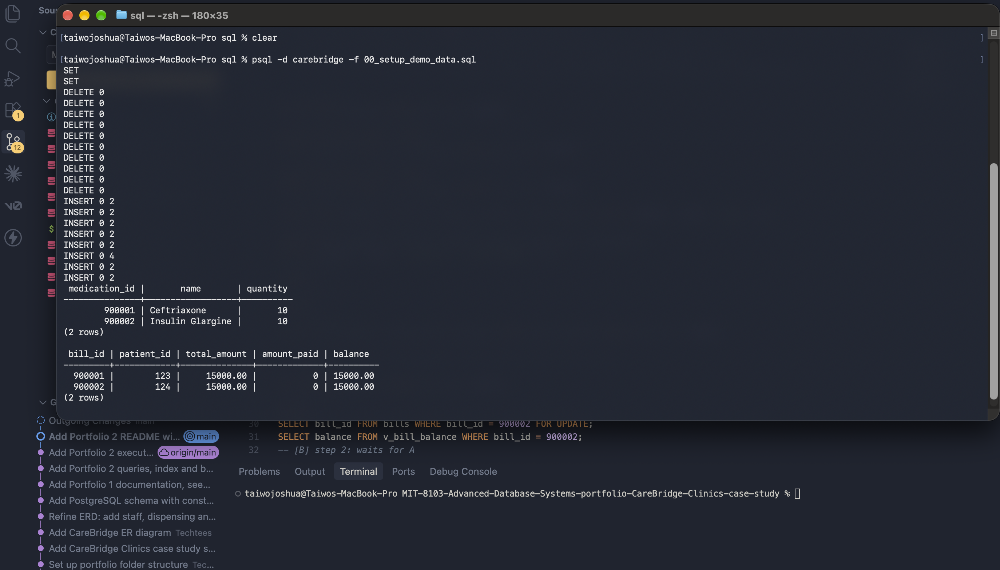

*The demo rows were created: 10 packs each of Ceftriaxone and Insulin Glargine at Lekki, and two ₦15,000 bills.*

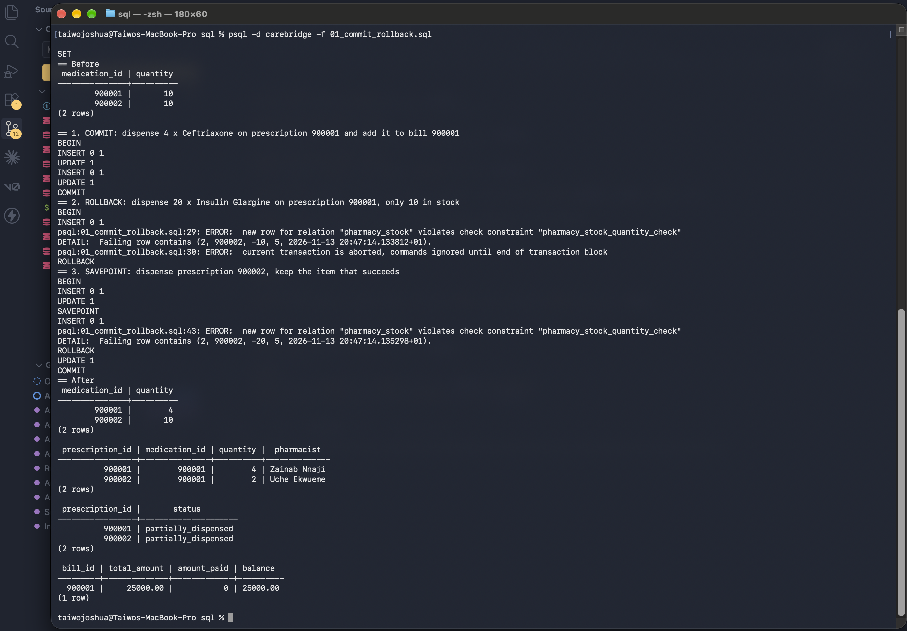

*The committed dispense changed all four tables, the failed insulin dispense was fully rolled back, and the savepoint kept only the item that succeeded.*

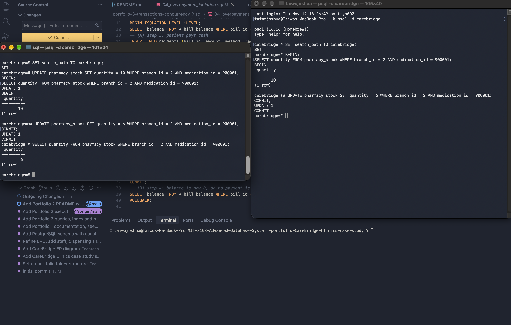

*Under READ COMMITTED both pharmacists read 10 and wrote 6, so one dispense of 4 packs was lost.*

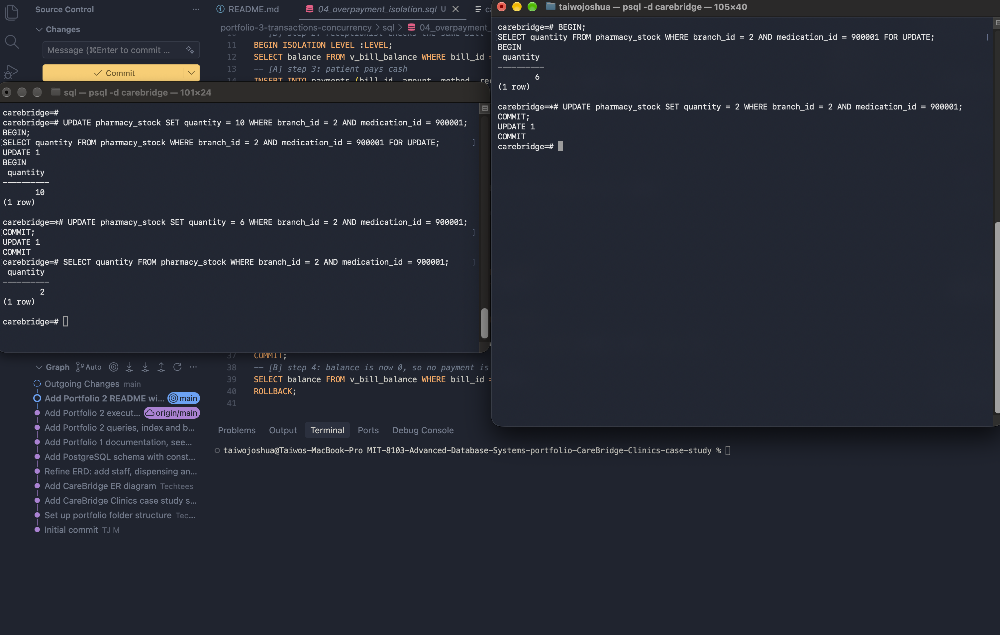

*With FOR UPDATE, session B waited, then read 6 and wrote 2, which is the correct final stock.*

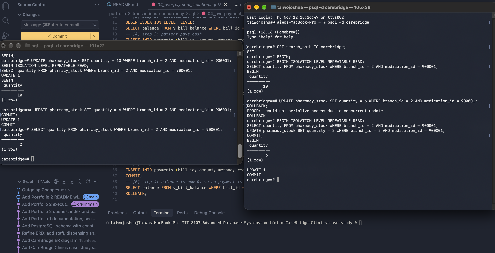

*Under REPEATABLE READ, B's update was rejected with a serialization error. The retry read 6 and wrote 2.*

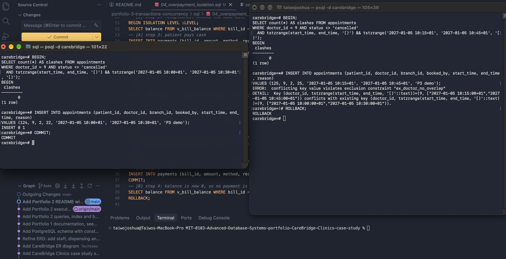

*Both receptionists saw 0 clashes, but the second overlapping booking was rejected by `ex_doctor_no_overlap` once the first committed.*

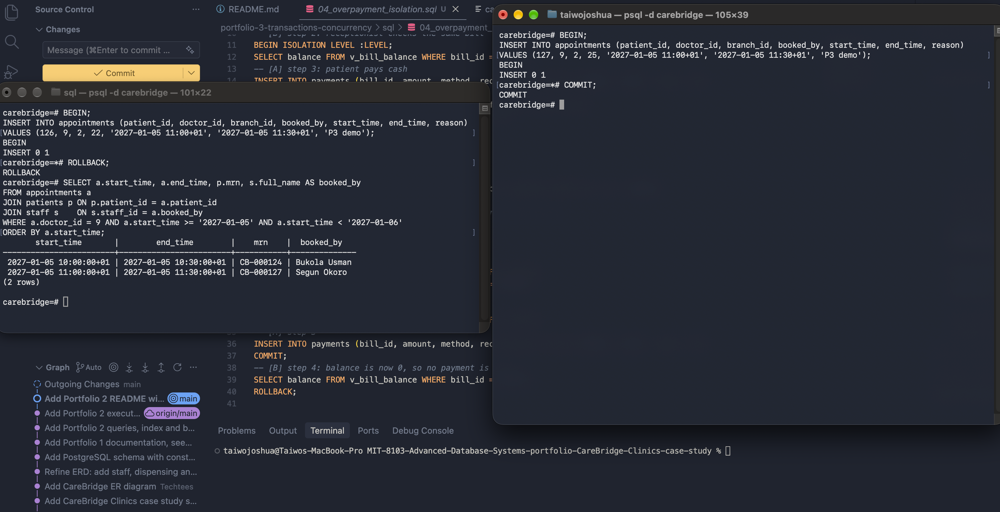

*When the first booking was rolled back, the waiting booking succeeded, so only one appointment holds the 11:00 slot.*

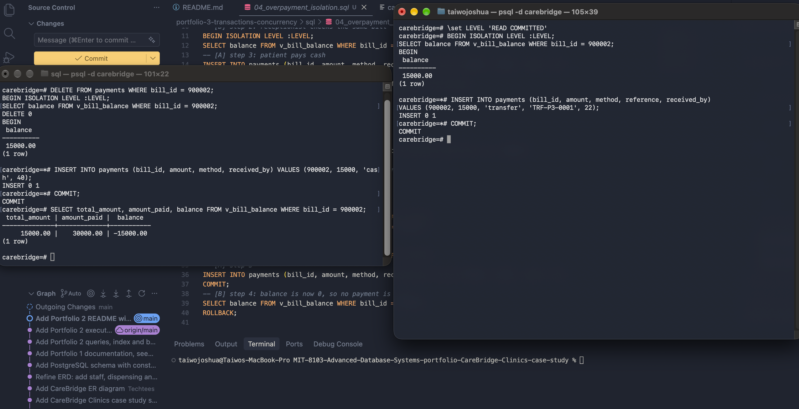

*Under READ COMMITTED both payments were accepted, and the bill was overpaid with a balance of −₦15,000.*

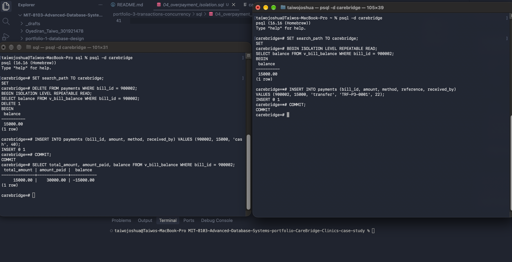

*REPEATABLE READ also accepted both payments, which shows write skew is not prevented at this level.*

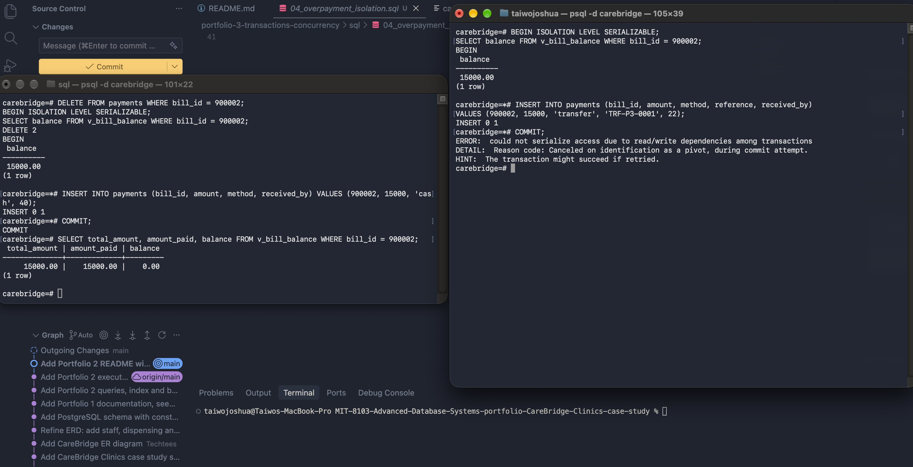

*SERIALIZABLE cancelled the second payment at COMMIT with a read/write dependency error, so the balance stayed at ₦0.*

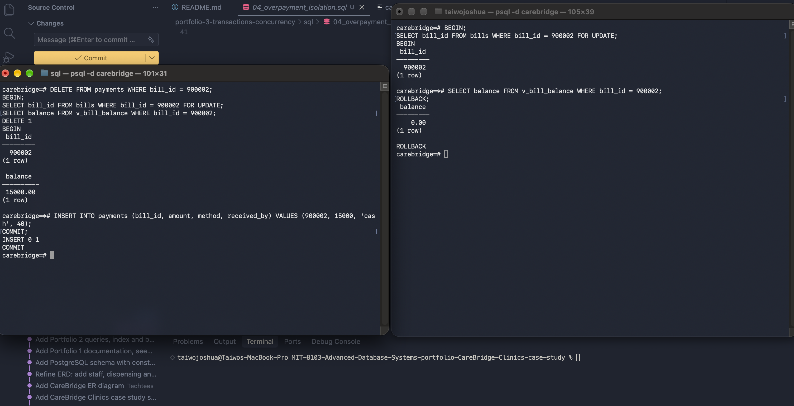

*Locking the bill row made B wait. It then saw a balance of ₦0 and took no second payment.*

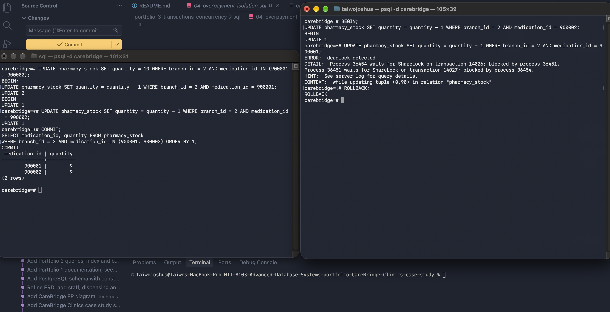

*Locking in opposite order caused `deadlock detected`. PostgreSQL rolled back one transaction and the other completed (9 and 9).*

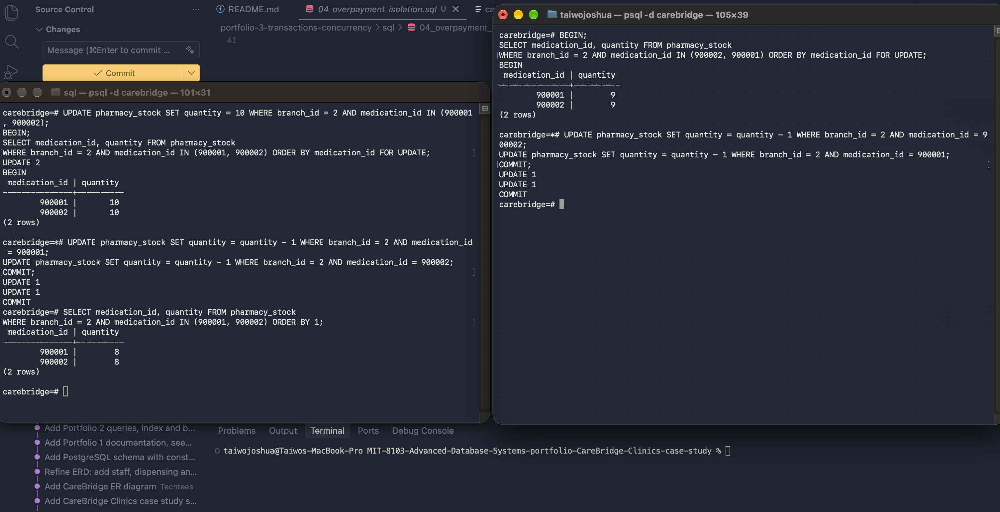

*Locking both rows in `medication_id` order turned the deadlock into a wait, and both dispenses were saved (8 and 8).*

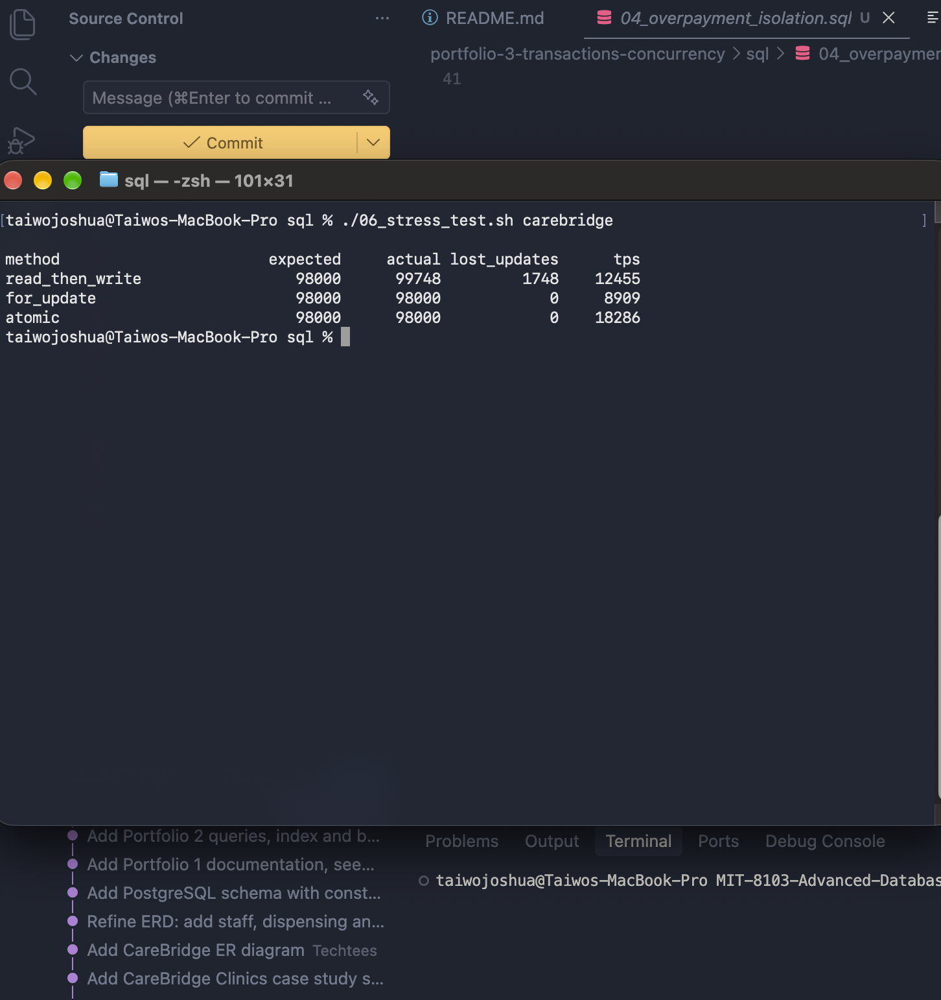

*Under 10 concurrent clients the read-then-write method lost 1,748 updates, while FOR UPDATE and the atomic UPDATE lost none. The atomic UPDATE was the fastest.*
