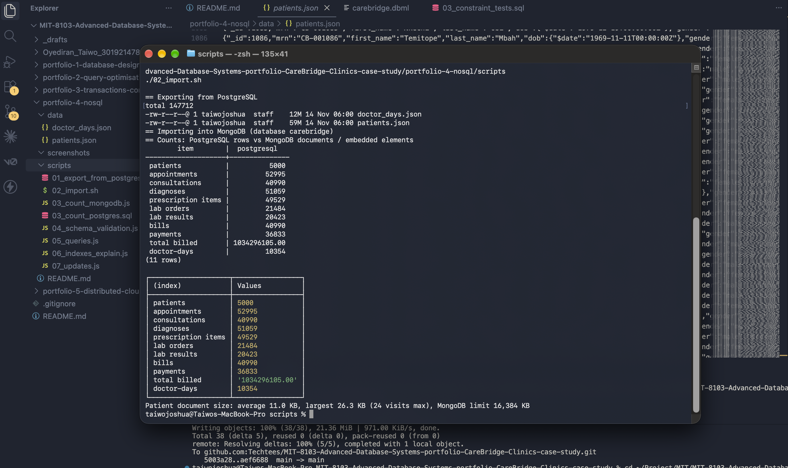
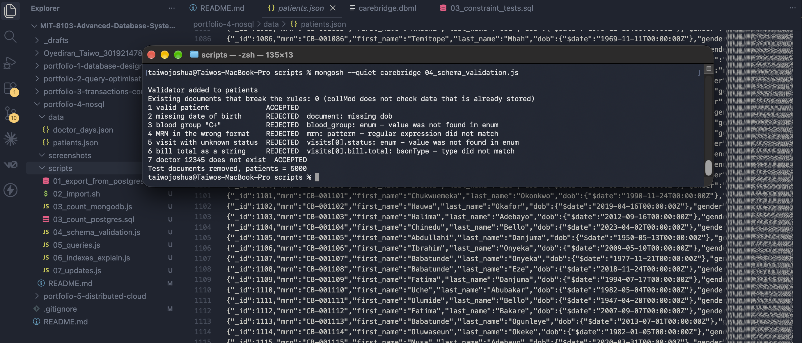
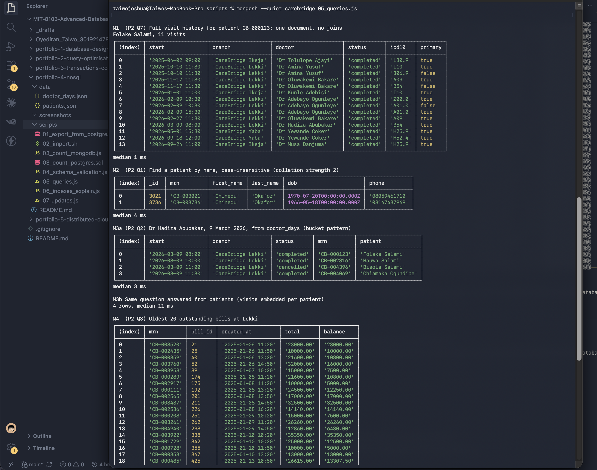
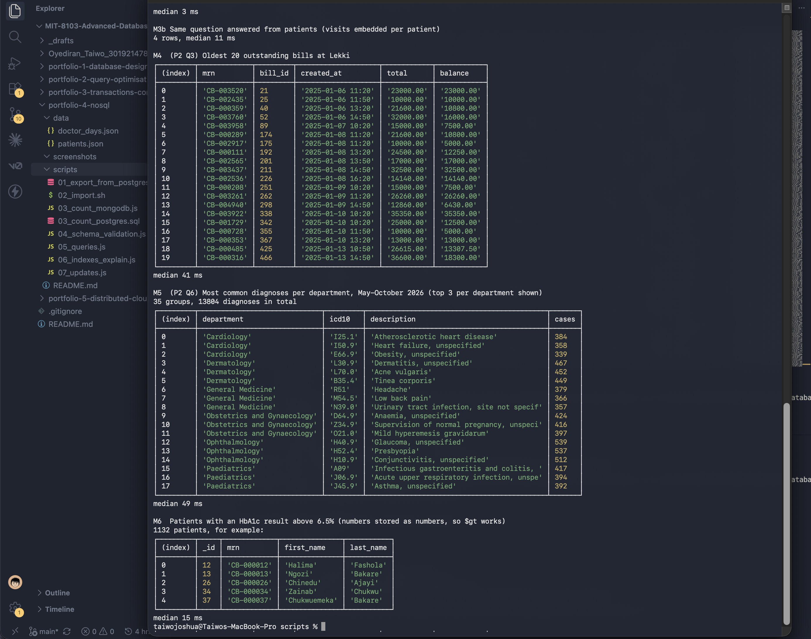
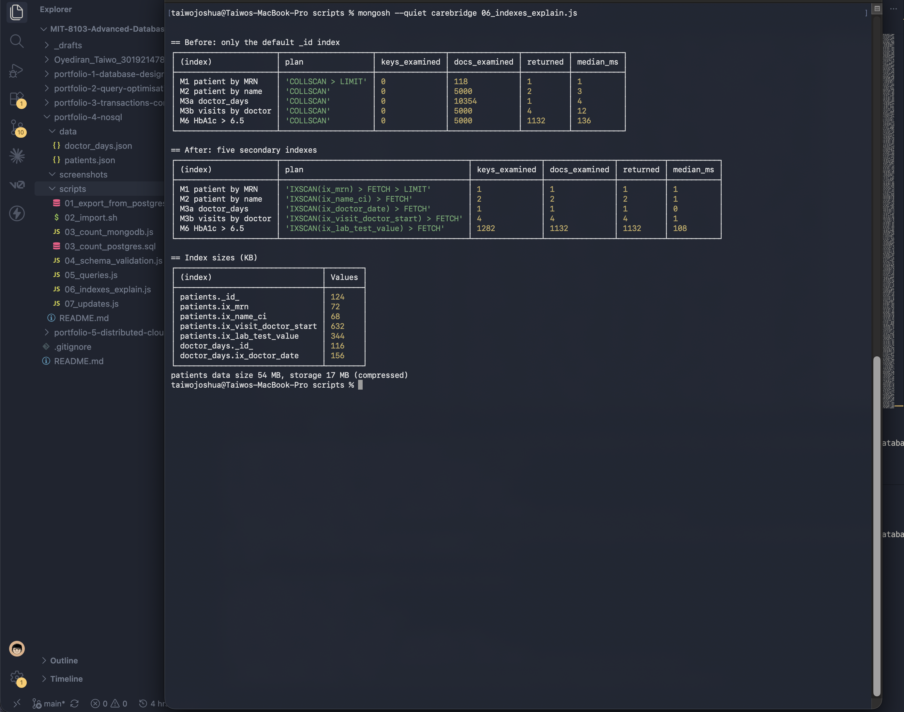
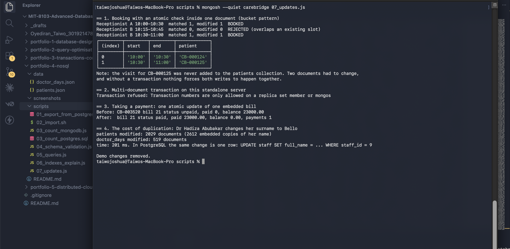

# Portfolio 4: NoSQL Data Model (MongoDB)

In this portfolio I redesigned the CareBridge database as documents in MongoDB, migrated all of the Portfolio 1 data into it (5,000 patients and every visit, diagnosis, prescription, lab result, bill and payment), and re-ran the Portfolio 2 workload against it. The aim was not to replace PostgreSQL but to find out which parts of CareBridge suit a document model and which parts do not, using real queries, plans and updates as evidence.

**DBMS:** MongoDB 7.0 (standalone `mongod`, `mongosh`, `mongoimport`) · **Source data:** the `carebridge` PostgreSQL database

## Contents

| File | Purpose |
|---|---|
| [scripts/01_export_from_postgres.sql](scripts/01_export_from_postgres.sql) | Builds one JSON document per patient and per doctor-day directly in PostgreSQL |
| [scripts/02_import.sh](scripts/02_import.sh) | Runs the export, loads both collections with `mongoimport`, compares counts |
| [scripts/03_count_postgres.sql](scripts/03_count_postgres.sql), [scripts/03_count_mongodb.js](scripts/03_count_mongodb.js) | The two sides of the count check |
| [scripts/04_schema_validation.js](scripts/04_schema_validation.js) | `$jsonSchema` validator and 7 test inserts |
| [scripts/05_queries.js](scripts/05_queries.js) | Portfolio 2 queries rewritten for MongoDB |
| [scripts/06_indexes_explain.js](scripts/06_indexes_explain.js) | `explain('executionStats')` before and after 5 indexes |
| [scripts/07_updates.js](scripts/07_updates.js) | Atomic booking and payment, transactions, cost of duplicated data |

The exported JSON files (about 70 MB) are written to `data/`, which is not committed because `02_import.sh` recreates them.

## 1. Why a Document Model, and for Which Data

- The most common read at CareBridge is "show me this patient": a doctor opening a patient's record before a consultation needs every past visit, diagnosis, prescription, lab result and bill. In PostgreSQL even the shorter version of this, Q7, is a join across six tables. That data is always read together, belongs to exactly one patient, and grows slowly (a few visits a year), so it fits naturally into one document per patient that can be read in a single lookup with no joins.
- I deliberately kept the data that many staff change at the same time in PostgreSQL: pharmacy stock, payments and appointment booking. Portfolio 3 showed that these need atomic updates on shared rows, constraints such as `ex_doctor_no_overlap`, and transactions across several tables to stay correct ([Portfolio 3](../portfolio-3-transactions-concurrency/)). Branch stock in particular is shared by every patient, so it does not belong inside any one patient's document. In this portfolio those records are only copied into the documents as history, not used as the place where the live values are kept.

## 2. Data Model

### `patients` (5,000 documents): embedding

```text
{ _id: 123, mrn: "CB-000123", first_name, last_name, dob, gender, phone, email, blood_group, home_branch,
  visits: [
    { appointment_id, start, status, branch,
      doctor: { id, name, department },
      consultation: {
        notes,
        diagnoses:     [ { code, description, primary } ],
        prescriptions: [ { issued_at, status, items: [ { medication, strength, quantity, dispensed, ... } ] } ],
        lab_tests:     [ { test, status, result: { value, unit, abnormal, summary } } ] },
      bill: { bill_id, status, total, paid, balance, items: [...], payments: [...] } } ] }
```

- **Embedding.** The `visits` array replaces `appointments`, `consultations`, `patient_diagnoses`, `prescriptions`, `prescription_items`, `dispensations`, `lab_orders`, `lab_results`, `bills`, `bill_items` and `payments`. That is safe here because every one of those rows belongs to exactly one patient and is never shared with another patient, so there is no risk of the same fact being stored in two patients' documents. Small lookup values (diagnosis description, medication name, test name) are copied in, because they are needed for display and almost never change.
- **Extended reference for `doctor`.** Each visit stores the doctor's `id` plus a copy of their `name` and `department`, so the history can be shown without looking anything up in another collection. The `id` is kept so the full doctor record can still be found. The downside is that the doctor's name is now repeated in thousands of places, so changing it is expensive (section 6).
- **Data types.** Money (`total`, `paid`, `balance`, prices) is stored as **Decimal128**, not a double: a double cannot hold values like 0.1 exactly, so adding up thousands of payments would drift by fractions of a naira, while Decimal128 keeps exact decimal values like PostgreSQL's `NUMERIC`. Dates are real BSON dates (exported as `{"$date": ...}`), so range queries and sorting work. Lab `result.value` is converted to a real number during export (e.g. HbA1c 7.2), so M6's `$gt: 6.5` works directly, whereas in PostgreSQL `value` is `VARCHAR` and needs a cast. The export would keep a non-numeric result as a string in the same field, which the flexible schema allows, but every result in this seed data is numeric.
- **Document size.** The average patient document is 11.0 KB and the largest is 26.3 KB (24 visits), far below MongoDB's 16 MB limit. Growth is bounded because a document only grows when that one patient has a visit, so even a frequent patient over many years stays in the tens or hundreds of KB.

### `doctor_days` (10,354 documents): bucket pattern

```text
{ doctor: { id: 9, name: "Dr Hadiza Abubakar", department: "Paediatrics" },
  date: "2026-03-09",
  slots: [ { start, end, branch, status, patient: { id, mrn, name } } ] }
```

The bucket pattern groups many small items into one document by a natural key: here one document holds all the appointments of one doctor on one day. It serves Q2, "Dr Abubakar's list for today", which then becomes a single document read (M3a) instead of searching inside 5,000 patients' visit arrays (M3b). Because all of a doctor's slots for the day are in one document, it also allows an overlap check and booking in one atomic update (section 6). The price is that every appointment is stored twice, once in the patient's `visits` and once in the doctor's day. I accepted that on purpose, because each copy serves a different main read, but it means a booking has to update two documents and keep them in step.

## 3. Migration

Each document is built inside PostgreSQL with `json_build_object` and nested `json_agg` sub-queries (one line of JSON per patient and per doctor-day), written to `data/` with psql, and loaded with `mongoimport --drop`. The count check then compares the PostgreSQL rows with the number of documents and embedded array elements in MongoDB.

| Item | PostgreSQL rows | MongoDB |
|---|---|---|
| Patients | 5,000 | 5,000 documents |
| Appointments → visits | 52,995 | 52,995 visits |
| Consultations | 40,990 | 40,990 |
| Diagnoses | 51,059 | 51,059 |
| Prescription items | 49,529 | 49,529 |
| Lab orders / results | 21,484 / 20,423 | 21,484 / 20,423 |
| Bills / payments | 40,990 / 36,833 | 40,990 / 36,833 |
| Total billed (₦) | 1,034,296,105.00 | 1,034,296,105.00 |
| Doctor-days | 10,354 | 10,354 documents |

Every count and the total billed amount match exactly, so nothing was lost or duplicated during the migration.

The problem I found: the first export wrote 754 patients with `blood_group: null`, because `json_build_object` outputs SQL `NULL` as JSON `null`. When I added the validator with `collMod`, nothing complained, because `collMod` only applies the rules to future inserts and updates and does not check documents that are already stored. It only showed up later, when an update to one of those patients was rejected: `null` is not one of the allowed blood-group values in the `enum`. I fixed the export by wrapping the objects in `json_strip_nulls`, so a missing value is left out of the document instead of being stored as `null` (the field is optional in the schema). After re-importing, the validation script reports 0 existing documents that break the rules.

## 4. Schema Validation

| Test | Result |
|---|---|
| Valid patient | Accepted |
| Missing date of birth | Rejected: `document: missing dob` |
| Blood group "C+" | Rejected: `blood_group: enum - value was not found in enum` |
| MRN "999004" | Rejected: `mrn: pattern - regular expression did not match` |
| Visit with status "done" | Rejected: `visits[0].status: enum - value was not found in enum` |
| Bill total as a string | Rejected: `visits[0].bill.total: bsonType - type did not match` |
| Visit with doctor 12345, who does not exist | **Accepted** |

The last test shows the limit of `$jsonSchema`: it checks that one document has the right shape and types, but it cannot look at other documents or collections, so there are no foreign keys. A visit can point to a doctor who does not exist, which PostgreSQL would have rejected with a foreign key error. In MongoDB, keeping references valid is the application's job.

## 5. Queries and Indexes

| # | Question | MongoDB approach | Result (matches PostgreSQL?) |
|---|---|---|---|
| M1 (Q7) | Visit history for CB-000123 | `findOne({ mrn })`: one document, no joins | Yes: Folake Salami, 11 visits, the same 14 diagnosis rows as Q7 |
| M2 (Q1) | Patient by name, any case | `find` with `collation({ locale: 'en', strength: 2 })` | Yes: the same two Chinedu Okafor patients (CB-003021, CB-003736) |
| M3a (Q2) | Dr Abubakar's day | `findOne` on `doctor_days` by `doctor.id` + `date` | Yes: the same 4 appointments (08:00, 10:00, 11:00 cancelled, 11:30) |
| M3b | Same, from `patients` | `$match` with `$elemMatch` → `$unwind` → `$match` → `$sort` | Yes: 4 rows, but 11 ms against 3 ms for M3a |
| M4 (Q3) | Oldest 20 outstanding Lekki bills | `$unwind` visits → `$match` branch/status → `$sort` → `$limit 20` | Yes: same 20 bills (21, 25, 40 … 466) with the same totals and balances |
| M5 (Q6) | Diagnoses per department, May–Oct 2026 | `$unwind` visits → `$match` date → `$unwind` diagnoses → `$group` | Yes: 35 groups and 13,804 diagnoses, the same counts as Q6 |
| M6 | Patients with HbA1c > 6.5 | `find` with `$elemMatch` on `lab_tests` and a numeric `$gt` | Yes: 1,132 patients, the same as PostgreSQL with `value::numeric > 6.5` (the cast is needed because `value` is text there) |

### `explain('executionStats')` before and after indexing

| Query | Before: plan / docs examined | After: plan / keys / docs examined |
|---|---|---|
| M1 | COLLSCAN > LIMIT / 118 | IXSCAN `ix_mrn` / 1 key / 1 doc |
| M2 | COLLSCAN / 5,000 | IXSCAN `ix_name_ci` / 2 keys / 2 docs |
| M3a | COLLSCAN / 10,354 | IXSCAN `ix_doctor_date` / 1 key / 1 doc |
| M3b | COLLSCAN / 5,000 | IXSCAN `ix_visit_doctor_start` / 4 keys / 4 docs |
| M6 | COLLSCAN / 5,000 (136 ms) | IXSCAN `ix_lab_test_value` / 1,282 keys / 1,132 docs (108 ms) |

- **M1 before = 118 documents.** The query has `.limit(1)`, so the collection scan stops at the first match. The scan reads documents in the order they are stored. The export file is in `_id` order, but `mongoimport` inserts in parallel batches, so the storage order is close to, but not exactly, `_id` order, and CB-000123 (`_id` 123) was reached after 118 documents. That number is luck; a patient near the end of the collection would have needed nearly all 5,000. The unique index makes it 1 key and 1 document for any patient.
- **M2 collation.** The query uses a case-insensitive collation (strength 2, so "okafor" = "Okafor"). An index stores keys compared in a particular way, and MongoDB can only use it if the index was created with the same collation as the query. A normal index on `last_name` would be ignored. This is the same idea as the `lower()` expression index in Portfolio 2: the index has to be built on the same thing the query compares.
- **Multikey indexes.** When an indexed field is inside an array, MongoDB creates one index key for every array element, so a patient with several HbA1c results has several keys pointing to the same document. That is why M6 examined 1,282 keys (one per HbA1c result above 6.5) but only 1,132 documents (one per patient, after duplicates are removed).
- **Why M6 is still about 100 ms.** The index finds the right patients, but it still has to fetch and return 1,132 whole documents of about 11 KB each, roughly 12 MB, because this test query has no projection. With a projection of only the name fields (as in `05_queries.js`, which runs before the indexes exist), the query took 15 ms even without an index. Much of the cost is reading and sending the large embedded documents, not finding them.
- **M4 and M5.** Both have to `$unwind` the visits of every patient before they can filter or group, because the conditions are on embedded bills or visits and the result is one row per visit, not per patient. M4 took 41 ms against 0.047 ms for Q3b in PostgreSQL, which used a partial index on `bills` and read just 20 rows. M5 took 49 ms against about 13 ms for Q6. Embedding is ideal for one patient, but it makes reports across all patients slower, because the data is grouped the wrong way for them. The MongoDB times include returning results to mongosh, while the PostgreSQL times are server execution only from `EXPLAIN ANALYZE`, so the gap is somewhat overstated, but the pattern is the same.

## 6. Writes, Atomicity and Duplication

| Operation | What happened | Lesson |
|---|---|---|
| Booking with an overlap check | Using one `updateOne` on the `doctor_days` document with the condition "no slot overlaps this time" plus `$push`: 10:00–10:30 was booked, 10:15–10:45 matched 0 documents and was rejected, and 10:30–11:00 was booked. | A single-document update is atomic, so with the bucket pattern the check and the insert happen together and two receptionists cannot double-book, like the exclusion constraint in Portfolio 3. |
| Two documents for one booking | The visit for CB-000124 was also added to `patients`, but the visit for CB-000125 was never written there, even though the slot was booked in `doctor_days`. | Duplicated data means two writes. Without a transaction nothing guarantees both happen, so the two copies can disagree. |
| Multi-document transaction | Refused: `Transaction numbers are only allowed on a replica set member or mongos` | MongoDB supports multi-document transactions only on a replica set or sharded cluster, not on a standalone server, so this setup cannot make the two writes atomic. |
| Taking a payment | Bill 21 (CB-003520): one `updateOne` with `$push` of the payment, `$inc` of `paid`/`balance` and `$set` of `status` took it from unpaid, balance ₦23,000 to paid, balance ₦0.00, 1 payment. | Because the bill and its payments are in one document, the whole payment is one atomic update with no transaction needed. |
| Doctor changes surname | Renaming Dr Hadiza Abubakar to Bello changed 2,029 patient documents (2,612 embedded copies of her name) and 519 `doctor_days` documents, in 201 ms. | The extended reference makes reads fast but makes changing shared data expensive. In PostgreSQL it is one row in `staff`. |

## 7. Relational vs Document: Conclusions

| | PostgreSQL (Portfolios 1–3) | MongoDB (this portfolio) |
|---|---|---|
| One patient's full history | A 6-table join (Q7), fast because of indexes | One document read (M1), no joins, 1 index key |
| Reports across all patients | Fast with the right indexes (Q3b 0.047 ms, Q6 ≈ 13 ms) | Slower: needs `$unwind` of every visit (M4 41 ms, M5 49 ms) |
| Integrity rules | Foreign keys, CHECK, UNIQUE and EXCLUDE constraints enforced across tables | `$jsonSchema` checks one document's shape only, with no foreign keys (doctor 12345 accepted) |
| Multi-record consistency | ACID transactions across any number of tables | Atomic within one document. Multi-document transactions need a replica set |
| Changing shared data | One row (`UPDATE staff …`) | 2,029 + 519 documents and 2,612 copies to update |
| Varying data (lab results) | One text column for every kind of result, so numeric comparisons need casting | Stored as numbers, so numeric queries work directly (M6); the same field could also hold text if needed |

My recommendation: PostgreSQL stays the system of record for CareBridge. All writes, especially stock, bookings and payments, go there, because these need constraints and multi-table transactions to stay correct when many staff work at the same time. MongoDB is useful as a read-optimised copy of each patient's full history, refreshed from PostgreSQL, for the patient-record screen and for flexible clinical data such as lab results. That way each database does what this portfolio showed it does best, and the duplicated data in MongoDB is never the only copy.

## 8. How to Run

```bash
cd portfolio-4-nosql/scripts
./02_import.sh
mongosh --quiet carebridge 04_schema_validation.js
mongosh --quiet carebridge 05_queries.js
mongosh --quiet carebridge 06_indexes_explain.js
mongosh --quiet carebridge 07_updates.js
```

`02_import.sh` drops and reloads both collections, which also removes the validator and indexes, so run the scripts in this order.

## 9. Evidence



*The export and import ran, and every PostgreSQL row count and the ₦1,034,296,105.00 total billed match MongoDB exactly. Patient documents average 11.0 KB, with the largest at 26.3 KB.*



*The validator found 0 stored documents breaking the rules and rejected 5 invalid inserts with the reason, but accepted a visit for a doctor who does not exist.*



*M1–M4 return the same results as the Portfolio 2 queries: CB-000123's history in one document, the two Chinedu Okafors, Dr Abubakar's 4 appointments, and the oldest outstanding Lekki bills.*



*M5 groups the same 13,804 diagnoses into 35 department/diagnosis pairs as Q6, and M6 finds 1,132 patients with HbA1c above 6.5 using a numeric comparison.*



*Before indexing every query was a COLLSCAN. After indexing each one uses its index (IXSCAN), and M6's multikey index examines 1,282 keys for 1,132 documents.*



*The atomic booking rejected the overlapping slot, the multi-document transaction was refused on a standalone server, the payment updated one embedded bill atomically, and the doctor's name change touched 2,548 documents.*
