# Portfolio 5: Distributed and Cloud Databases

CareBridge runs three branches that share one set of patient records, and a patient can be seen at any of them, so the database has to stay available and correct even when a server or a network link fails. A single database server is a single point of failure: if it goes down, every branch stops registering, booking and billing. In this portfolio I built and tested two distributed set-ups on my machine: PostgreSQL streaming replication (a primary and a hot-standby replica), and a MongoDB sharded cluster with one shard per branch. I used them to observe replication lag, stale reads, synchronous commit, failover, query routing, distributed transactions and shard failure. The portfolio ends with the CAP choices I would make for each kind of CareBridge data and a proposed cloud deployment.

**DBMS:** PostgreSQL 16, MongoDB 7.0 · **Data:** the Portfolio 1 database and the Portfolio 4 documents

## Contents

| File | Purpose |
|---|---|
| [scripts/replication/01_setup_replica.sh](scripts/replication/01_setup_replica.sh) | `pg_basebackup` copy of the primary, replication slot, start the replica on 5433 |
| [scripts/replication/02_read_write.sh](scripts/replication/02_read_write.sh) | Write on primary, read on replica, replica refuses writes |
| [scripts/replication/03_stale_read.sh](scripts/replication/03_stale_read.sh) | Replica behind the primary (stale read) |
| [scripts/replication/04_sync_replication.sh](scripts/replication/04_sync_replication.sh) | Asynchronous vs synchronous commit, replica down during synchronous commit |
| [scripts/replication/05_failover.sh](scripts/replication/05_failover.sh) | Promote the replica, split brain |
| [scripts/replication/99_teardown_replica.sh](scripts/replication/99_teardown_replica.sh) | Remove the replica and slot, restore settings |
| [scripts/sharding/01_start_cluster.sh](scripts/sharding/01_start_cluster.sh) | Config server, 3 shards, `mongos` |
| [scripts/sharding/02_load_data.sh](scripts/sharding/02_load_data.sh) + [02_shard_patients.js](scripts/sharding/02_shard_patients.js) | Zones per branch, shard `patients`, load data |
| [scripts/sharding/03_routing.js](scripts/sharding/03_routing.js) | Targeted vs scatter-gather queries, unique index limit, shard key analysis |
| [scripts/sharding/04_distributed_transaction.js](scripts/sharding/04_distributed_transaction.js) | Transaction across two shards, moving a document between shards |
| [scripts/sharding/05_shard_failure.sh](scripts/sharding/05_shard_failure.sh) | Yaba shard down: what still works |
| [scripts/sharding/99_stop_cluster.sh](scripts/sharding/99_stop_cluster.sh) | Stop the cluster and delete its data |

Both set-ups keep their data in `~/carebridge-p5`, outside the repository.

## Part A: PostgreSQL Streaming Replication

### A1. Set-up

`pg_basebackup` takes a full physical copy of the running primary (111 MB). The `-R` option writes the connection settings (`primary_conninfo`) and a `standby.signal` file, so the copy starts as a standby instead of a normal server. `-C -S carebridge_replica_slot` creates a **replication slot** on the primary. The replica then runs as a **hot standby**: it continuously receives the primary's write-ahead log (WAL) over a streaming connection and replays it, and it accepts read-only queries while doing so. The slot makes the primary keep any WAL the replica has not received yet, so a replica that disconnects for a while can catch up instead of needing a new copy. The downside is that if the replica is down for a long time, the primary keeps that WAL forever and its disk can fill up, which is why the teardown script drops the slot. After starting, `pg_stat_replication` on the primary showed `carebridge_replica` in state `streaming`, `async`, with `sent_lsn` and `replay_lsn` equal (0/52000060), and on port 5433 `pg_is_in_recovery()` returned `t` with all 5,000 patients present.

### A2. Reads and Writes

| Action | Result |
|---|---|
| Register patient CB-900001 on the primary | Inserted as patient_id 5008 |
| Read it on the replica | Found 0.5 s later (5008, Ifeoma Replica) |
| Replication lag | `replay_lag` 00:00:00.003052 (about 3 ms), 0 bytes behind |
| INSERT / UPDATE on the replica | `ERROR: cannot execute INSERT in a read-only transaction` (and the same for UPDATE) |

A replica is useful for spreading out read work, such as doctors' screens and reports, and as a ready copy if the primary fails, but every write must go to the primary because only the primary creates WAL. If both servers accepted writes, their copies would no longer match.

### A3. Stale Reads

With WAL replay paused on the replica, a patient registered on the primary (CB-900003) was found on the primary (count 1) but **not on the replica** (count 0), and the replica was 8,624 bytes of WAL behind. After replay was resumed, the replica found the patient and the lag returned to 0. This is **eventual consistency**: the replica will catch up, but for a short time it can return old data. Normally that is only a few milliseconds, but a busy or slow replica can fall seconds behind. For clinical data this matters: a doctor reading from a replica straight after a new allergy or result was recorded could miss it. Reads that must be up to date (allergies, active prescriptions, a patient just registered at reception, anything read straight after the user's own write) should go to the primary, or wait until the replica has replayed past that write's LSN. Reports and history screens can safely use the replica.

### A4. Synchronous vs Asynchronous Commit

| Mode | Commit returns when… | Average commit latency | Transactions/s |
|---|---|---|---|
| Asynchronous | the primary has written the change to its own WAL | 0.040 ms | 25,034 |
| Synchronous | the replica has also written the change to its own disk and confirmed it | 0.086 ms | 11,591 |

With `synchronous_standby_names = 'carebridge_replica'` I stopped the replica and started an INSERT. The INSERT did not fail. It hung with `wait_event = SyncRep` (still waiting after 5 seconds), because the primary will not report a commit until the replica confirms it, and there was no replica. Cancelling it with `pg_cancel_backend` produced the warning *"canceling wait for synchronous replication due to user request"* with the detail *"The transaction has already committed locally, but might not have been replicated to the standby."* The row (id 183136) was in fact on the primary. This is CAP in practice: when the network to the replica is lost (a partition), synchronous mode chooses **consistency over availability**: it would rather stop accepting writes than confirm data that only one server has. Production systems avoid a single replica stopping all writes by having at least two standbys and a rule such as `synchronous_standby_names = 'ANY 1 (s1, s2)'`, so any one of them can confirm, and by using a failover manager that changes the setting when a standby is lost.

### A5. Failover and Split Brain

Before failover the replica reported `is_replica = t` on timeline 1. `pg_promote()` turned it into a primary: `pg_is_in_recovery()` became `f` and the timeline moved from 1 to 2, which marks the point where its history splits from the old primary's. The new primary accepted a write (CB-900010). But the old primary on 5432 was still running and also accepted a write (CB-900011). Each server then had only its own patient: the new primary had CB-900010 and the old one had CB-900011. This is **split brain**: two servers both acting as the primary with different data, which cannot simply be merged and could mean, for example, two patients given the same MRN. **Fencing** means making sure the old primary can no longer accept writes before the new one is promoted, for example by shutting it down, cutting its network access or moving the virtual IP address. Tools like Patroni prevent split brain by using a distributed consensus store (etcd, Consul or ZooKeeper) to hold a leader lock: only the server holding the lock may act as primary, and a primary that loses contact with the store demotes itself.

## Part B: MongoDB Sharding

### B1. Cluster and Shard Key

The cluster has a **config server** (port 27019), which stores the metadata about which ranges of data (chunks) live on which shard; **three shards** (`shard_ikeja` 27101, `shard_lekki` 27102, `shard_yaba` 27103), each storing part of the data; and a **mongos** router (27100), which applications connect to and which sends each query to the right shards. Each server is a one-member replica set because MongoDB requires shards and config servers to be replica sets. `patients` is sharded on `{ home_branch: 1, _id: 1 }` with one **zone** per branch, so all of a branch's patients are kept on that branch's shard. `home_branch` alone would be a poor key: it has only three values, so each branch's patients would form one chunk that could never be split, a shard could not be balanced as a branch grows, and every query for one branch would hit just one huge chunk. Adding `_id` makes every key unique, so chunks can be split and moved inside a zone.

| Shard | Patients | Home branches stored | Chunks |
|---|---|---|---|
| shard_ikeja | 1,645 | CareBridge Ikeja only | 2 |
| shard_lekki | 1,704 | CareBridge Lekki only | 2 |
| shard_yaba | 1,651 | CareBridge Yaba only | 3 |

The total through mongos is 5,000 patients. The unsharded `doctor_days` collection (10,354 documents) all sits on its primary shard, `shard_lekki`.

### B2. Query Routing

| Query | mongos plan | Shards contacted |
|---|---|---|
| `{ home_branch, mrn }` | SINGLE_SHARD | 1 (shard_ikeja) |
| `{ mrn }` only | SHARD_MERGE | 3 (all) |
| Lekki patients born before 1960 | SINGLE_SHARD | 1 (shard_lekki) |
| Diagnoses per department (aggregation) | merge on mongos | 3 (all) |

When the query includes the shard key (or its first field, `home_branch`), mongos knows from the config server which shard holds that range and sends the query only there. That is a **targeted** query. Without the shard key it cannot know where the patient lives, so it sends the query to every shard and merges the answers. That is **scatter-gather**: it works, but it costs every shard some work and is only as fast as the slowest shard. The unique index on `mrn` was refused with *"cannot create index with 'unique' or 'prepareUnique' option over { mrn: 1 } with shard key pattern { home_branch: 1, _id: 1 }"*, because each shard can only check uniqueness among its own documents. Two shards could each accept the same MRN without knowing about the other, so MongoDB only allows unique indexes that start with the shard key. In PostgreSQL this is a single `UNIQUE` constraint.

### B3. Is Home Branch the Right Shard Key?

| | Visits |
|---|---|
| At the patient's home branch | 17,494 (33.0%) |
| At another branch | 35,501 (67.0%) |

Only 13 patients visited just one branch, while 4,574 of the 5,000 visited all three. So 67% of visits happen at a branch whose shard does not hold that patient's record. In this simulated data, visits are spread across branches because doctors rotate between them, so the idea of "data stored at the branch that uses it" does not hold. A real deployment should measure this before choosing a key, but if patients behave like this, then with a shard in each branch two out of three visits would read the record across the network from another branch. The alternatives are a **hashed `_id`** key, which spreads patients evenly with no hot shard but makes every branch query scatter-gather, or sharding the visit data by **the branch where the visit happens**, which is how Portfolio 1 stores `appointments.branch_id`. That keeps each branch's daily work (bookings, today's consultations, bills) local but splits a patient's history across shards. My recommendation is not to shard by branch at all: with 5,000 patients and 54 MB of data, CareBridge does not need sharding, and if it grew it should shard on a hashed patient id for even spread, with each shard replicated, rather than trying to tie patients to one branch.

### B4. Distributed Transactions

| Booking | Result |
|---|---|
| 10:00, slot on shard_lekki + visit on shard_yaba | COMMITTED: 1 slot in `doctor_days` and 1 visit in the patient document |
| 11:00, failure simulated after the slot | ABORTED: the slot already written was rolled back, so there is still only 1 slot and 1 visit |

In Portfolio 4 the same two-document booking could not be made atomic, because a standalone server refused transactions (*"Transaction numbers are only allowed on a replica set member or mongos"*). Through mongos it works even across two shards. MongoDB uses **two-phase commit**: one shard acts as the coordinator, asks every shard involved to *prepare* (make the change durable but not visible), and only when all have agreed does it tell them to *commit*. If any fails, all of them abort. The cost is extra network round trips and the changed data being locked until the decision is made, so these transactions are slower than single-shard ones and should be kept short and rare. Changing a shard key value also needs this: when CB-000004's `home_branch` changed from Ikeja to Lekki, the document was deleted from `shard_ikeja` and inserted on `shard_lekki` inside one transaction.

### B5. Losing a Shard

| Query (with `shard_yaba` stopped) | Result |
|---|---|
| Lekki patient (targeted) | OK, CB-000003 in 7 ms |
| Count Lekki patients (targeted) | OK, 1,704 in 9 ms |
| Doctor diary | OK, 4 slots in 5 ms (`doctor_days` is on shard_lekki) |
| Yaba patient (targeted) | FAIL after 5,028 ms: *operation exceeded time limit* |
| Count all patients (scatter-gather) | FAIL after 5,029 ms: *operation exceeded time limit* |

This is **fault isolation**: losing one shard only affects the data on it, so Ikeja and Lekki carry on working while Yaba's patients are unavailable. But any query that has to visit every shard, such as a total count or a report, fails while any shard is down. Here each shard is a single server, so each one is a single point of failure for its third of the data. After restarting shard_yaba, the full count returned 5,000 again. In production every shard is itself a replica set of three members (usually in different data centres), so if one member fails another is elected primary within seconds and the shard stays available.

## CAP and Consistency Choices for CareBridge

The CAP theorem says that when a network partition splits a distributed database, it has to choose between **consistency** (every read sees the latest write, so some requests must be refused) and **availability** (every request gets an answer, which may be out of date). Without a partition, both are possible.

| Data | Choice | Why |
|---|---|---|
| Booking, stock, payments | **CP**: write only to the primary, synchronous standby, reject writes if consistency can't be guaranteed | Double bookings, negative stock or double payments (Portfolio 3) cause real harm and are hard to undo. It is better for reception to wait briefly or retry than to accept a write that could conflict. |
| Allergies, active prescriptions, new results | **CP**: always read from the primary | A stale read (A3) could mean prescribing a drug the patient is allergic to. Patient safety outweighs a few milliseconds of latency. |
| Patient history screen | **AP**: read from a replica or the MongoDB read model | Past visits rarely change, so a copy that is a few seconds behind is acceptable, and the screen should still work if the primary is busy. Items needing CP (above) are shown from the primary. |
| Reports and dashboards | **AP**: replica or read model, eventually consistent | Monthly revenue and diagnosis counts do not need the latest second of data, and running them on a replica keeps that load off the primary. |

PACELC extends CAP: even with no partition (**E**lse), there is a trade-off between **L**atency and **C**onsistency. My A4 measurements show it: synchronous commit roughly doubled commit latency (0.040 → 0.086 ms) and halved throughput (25,034 → 11,591 tps), even with the replica on the same machine. Across a real network between data centres the extra latency would be milliseconds per commit, not microseconds.

## Proposed Cloud Deployment

```text
       Ikeja branch          Lekki branch          Yaba branch
            \                     |                     /
             \______ HTTPS / VPN (two ISPs per branch) _/
                                  |
                    CareBridge application (cloud)
                                  |
     +----------------------------+--------------------------------+
     |  Cloud region chosen to meet NDPA 2023 requirements         |
     |                                                             |
     |  Zone A                          Zone B                     |
     |  [PostgreSQL primary] --sync-->  [PostgreSQL standby]       |
     |          |                         (automatic failover)     |
     |          +--async--> [Read replica] --> reports, dashboards |
     |          |                                                  |
     |          +--change feed--> [MongoDB replica set: patient    |
     |                             history read model]             |
     |                                                             |
     |  Continuous WAL archive + daily backups (encrypted)         |
     |  --> point-in-time recovery, copy in a second region        |
     +-------------------------------------------------------------+
```

- **Managed PostgreSQL as the system of record**, with a primary in one availability zone and a **synchronous standby** in a second zone. The provider handles failover and fencing (A5), so if a zone fails the standby is promoted automatically without split brain and without losing committed bookings or payments.
- **Asynchronous read replicas** for reports, dashboards and the history screen, as in A2–A3. Reads that must be up to date stay on the primary.
- **MongoDB replica set as a read model** of each patient's full history (Portfolio 4), kept up to date from PostgreSQL. It is a copy for fast reads, never the place where data is changed.
- **Backups and point-in-time recovery**: continuous WAL archiving plus daily snapshots, encrypted and copied to a second region, so the database can be restored to any moment before a mistake (for example an accidental `DELETE`). Replication alone does not protect against this, because the mistake is replicated too.
- **No sharding yet.** The carebridge database is about 85 MB and the busiest table has about 100,000 rows; one server handles this easily, and B2–B5 showed that sharding adds scatter-gather queries, distributed transactions, no global unique constraints and more failure points. Scaling up the server and adding read replicas is enough for many years at CareBridge's size.
- **Data protection (Nigeria Data Protection Act 2023).** Health records are sensitive personal data under the NDPA, so they need a lawful basis for processing, encryption in transit (TLS) and at rest, role-based access (Portfolio 1's staff roles), audit logging of who viewed which record, a retention policy, and care over where the data is hosted: transferring it outside Nigeria requires the safeguards the Act sets out, so the region and the provider's contract must be chosen with that in mind.
- **When a branch loses its internet link**: the database itself keeps running in the cloud, but that branch cannot reach it. Each branch should have two internet links from different providers. If both fail, the branch falls back to a limited offline mode: viewing a locally cached copy of today's appointments and recent patient summaries (read-only, possibly stale) and recording new visits and payments on paper or in a local queue, to be entered once the link is back. It must not take bookings or dispense stock offline, because those need the CP guarantees above and could conflict with the other branches.

## Conclusions

- Replication gives availability and spreads read load, but asynchronous replicas can be stale (A3), so every read has to be classed as "must be current" or "can be slightly old" and sent to the primary or a replica accordingly.
- Consistency always has a cost. Synchronous commit halved throughput and, with the replica down, stopped writes entirely (A4). CAP and PACELC are not just theory: they showed up as concrete numbers and a hung INSERT.
- Failover is easy to trigger but dangerous without fencing. Promoting a replica while the old primary still runs produced split brain within seconds (A5), which is why automatic failover needs a proper tool rather than a manual script.
- Sharding is a trade-off, not a free upgrade. A shard key must match how the data is really used (67% of CareBridge visits are at another branch), cross-shard queries and transactions are slower, unique constraints across shards are lost, and each shard is another thing that can fail. For CareBridge's size, a replicated PostgreSQL server in the cloud is the right choice.

## How to Run

```bash
cd portfolio-5-distributed-cloud/scripts/replication
./01_setup_replica.sh
./02_read_write.sh
./03_stale_read.sh
./04_sync_replication.sh
./05_failover.sh
./99_teardown_replica.sh

cd ../sharding
./01_start_cluster.sh
./02_load_data.sh
mongosh --quiet --port 27100 carebridge 03_routing.js
mongosh --quiet --port 27100 carebridge 04_distributed_transaction.js
./05_shard_failure.sh
./99_stop_cluster.sh
```

## Evidence

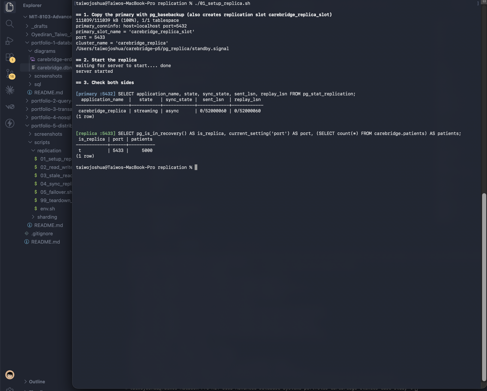

*The replica was created with `pg_basebackup` and a replication slot. It is streaming asynchronously, is in recovery, and has all 5,000 patients.*

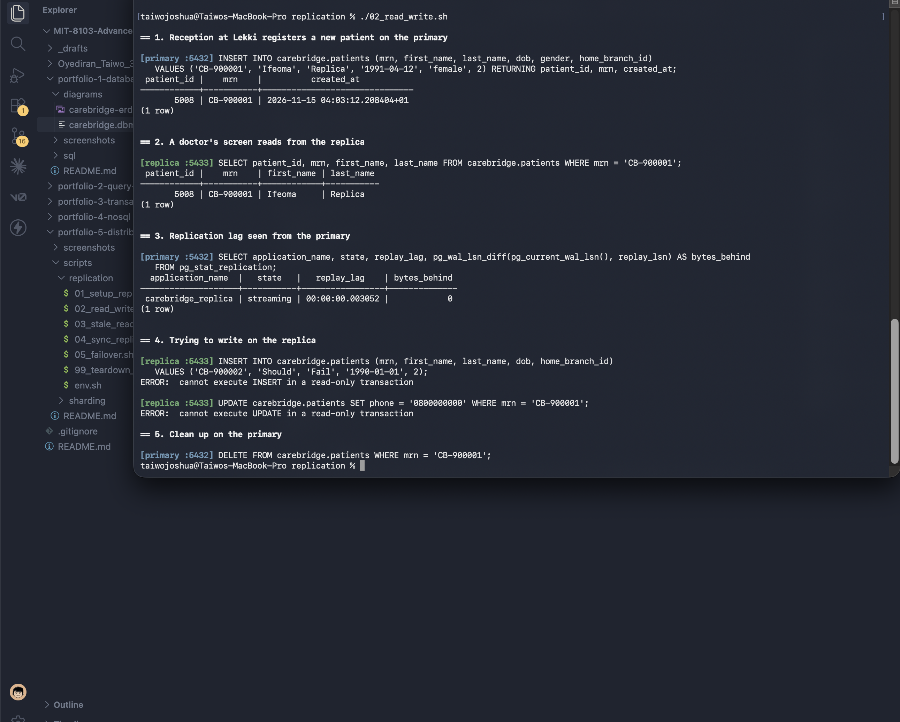

*A patient written on the primary appeared on the replica within about 3 ms, and the replica refused INSERT and UPDATE as read-only.*

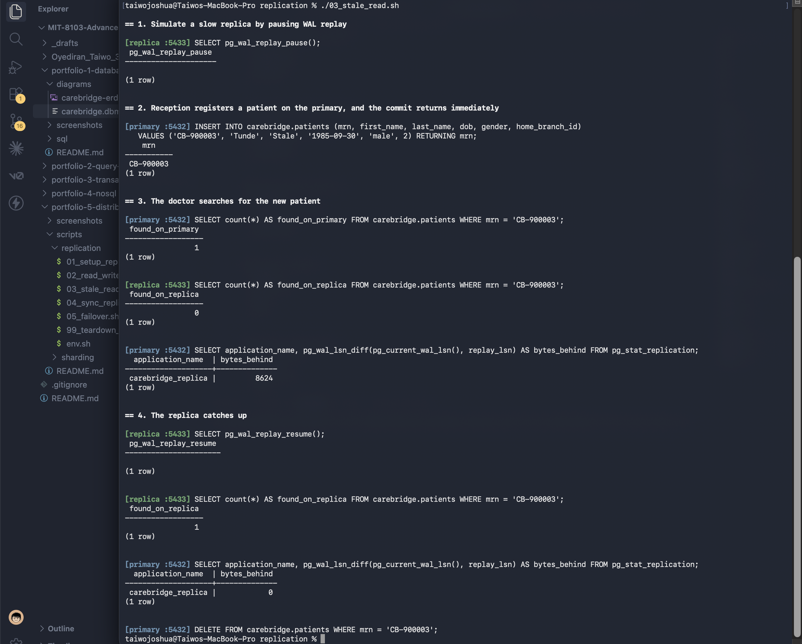

*With replay paused, the new patient was on the primary but not on the replica (8,624 bytes behind). After resuming, the replica caught up.*

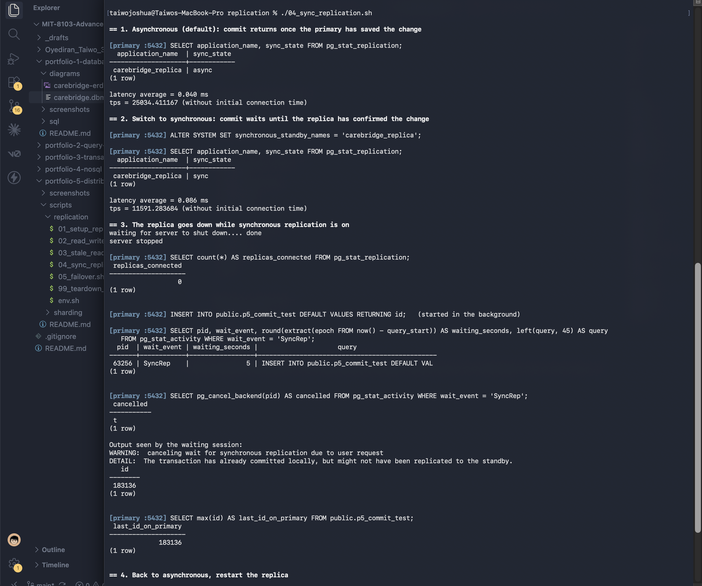

*Synchronous commit doubled latency and halved throughput. With the replica down, an INSERT hung in `SyncRep` until cancelled, after having already committed locally.*

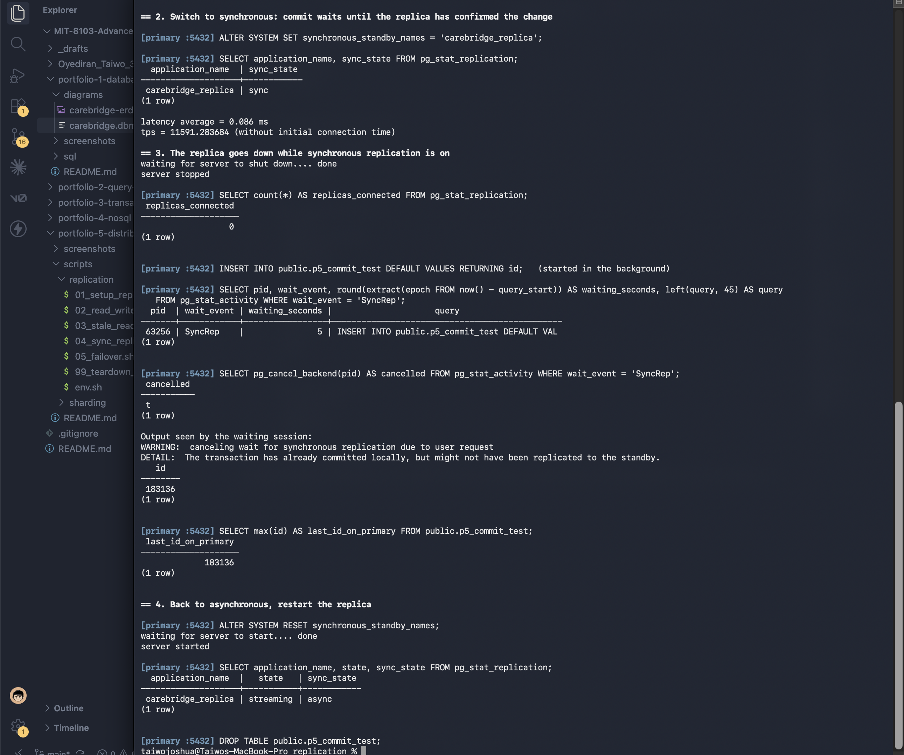

*Replication was switched back to asynchronous and the replica restarted and reconnected.*

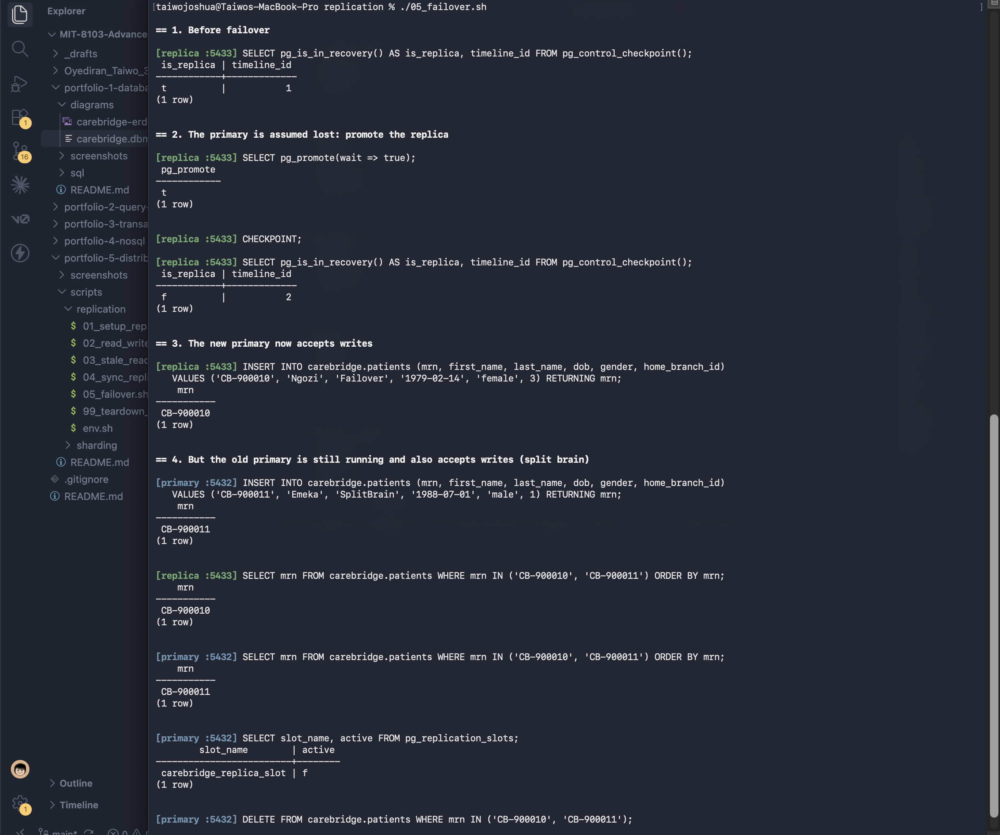

*`pg_promote()` moved the replica to timeline 2 as a new primary. The old primary also kept accepting writes, so the two servers held different patients (split brain).*

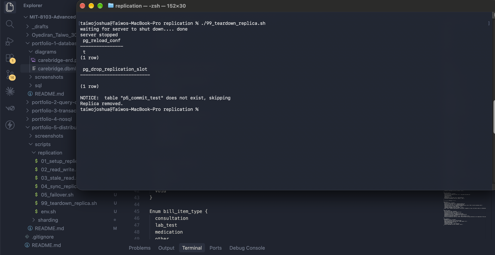

*The replica and its replication slot were removed, and the primary was returned to its original settings.*

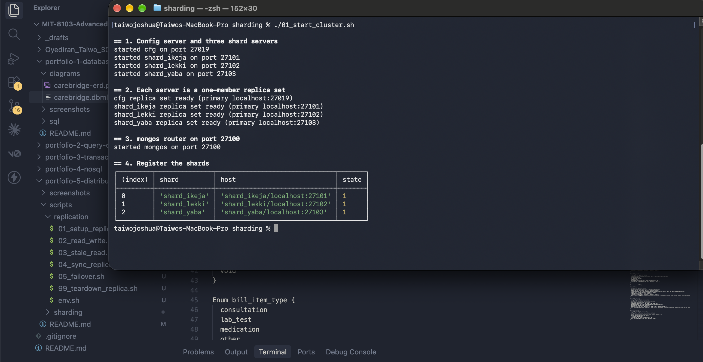

*The config server, three branch shards and the mongos router were started, and the shards were registered with the cluster.*

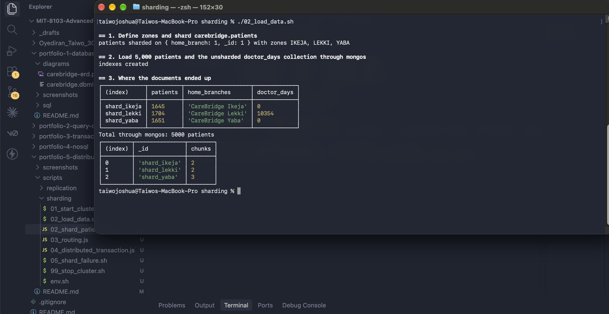

*Zones placed each branch's patients only on its own shard (1,645 / 1,704 / 1,651, total 5,000), with `doctor_days` on shard_lekki.*

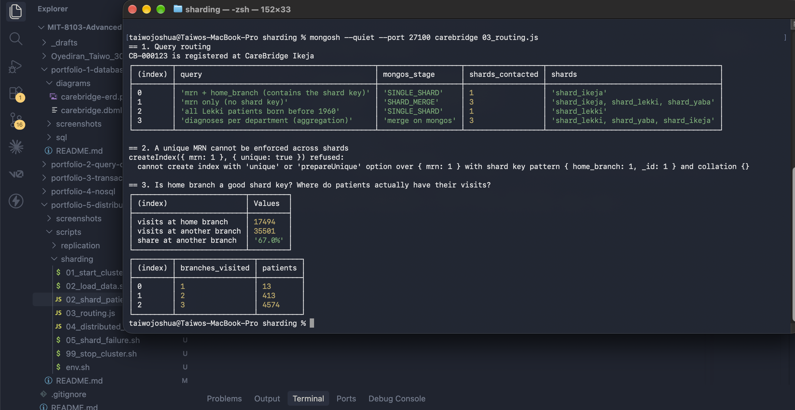

*Queries with the shard key went to one shard and queries without it went to all three. The unique MRN index was refused, and 67% of visits were at another branch.*

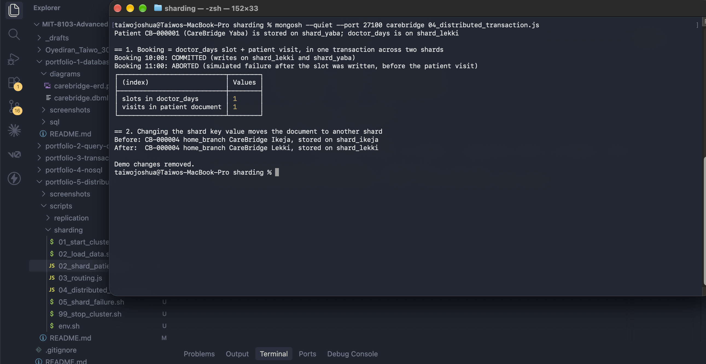

*A booking across shard_lekki and shard_yaba committed atomically, a simulated failure rolled back both writes, and changing the home branch moved a document to another shard.*

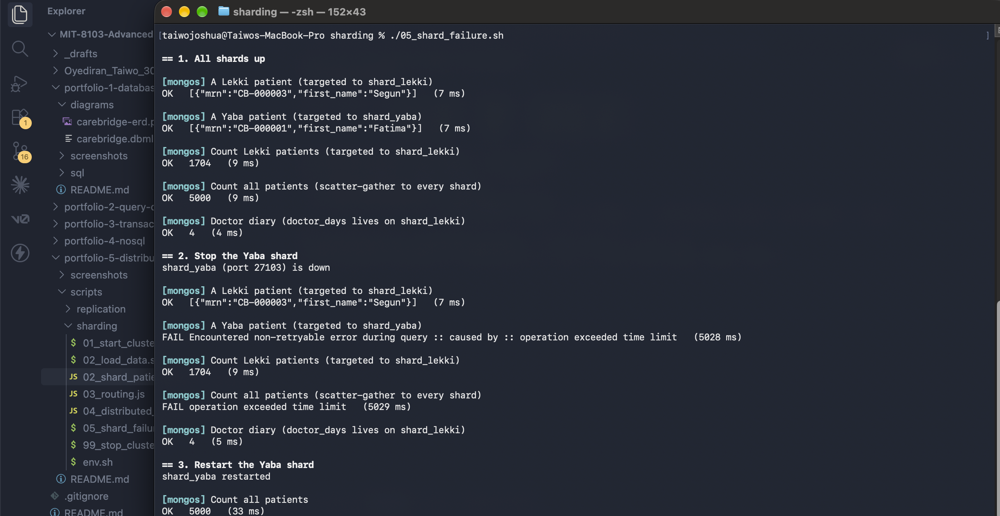

*With shard_yaba down, Lekki queries and the doctor diary still worked, while Yaba and scatter-gather queries timed out until the shard was restarted.*
